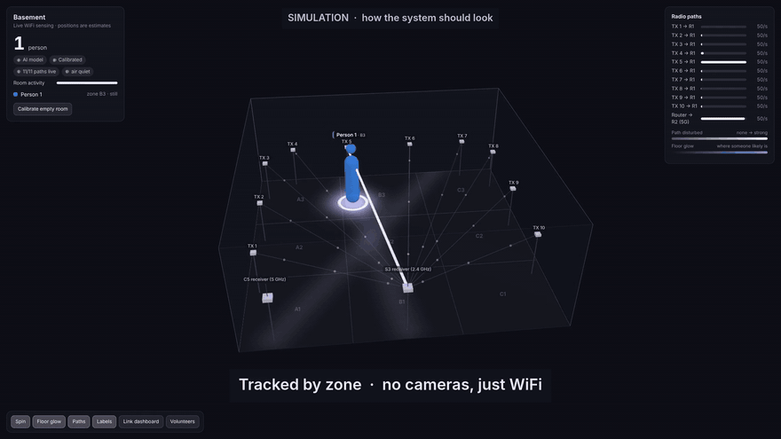
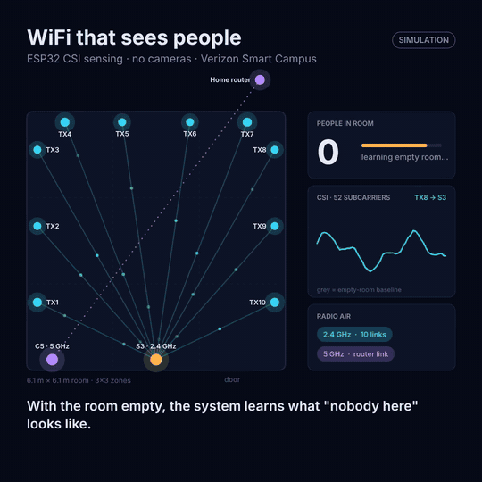
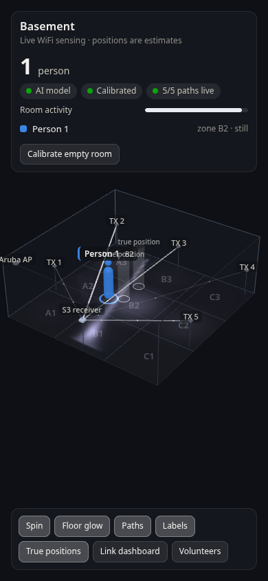
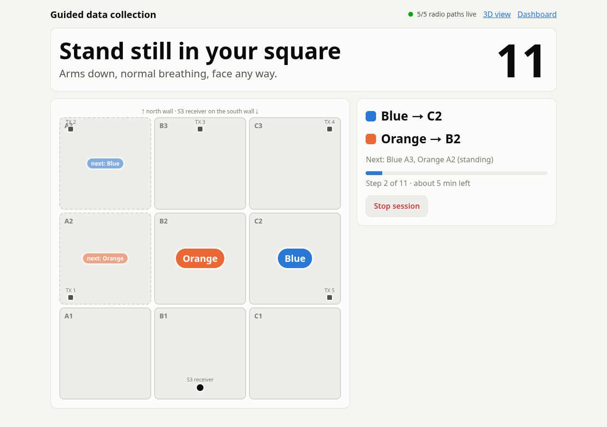
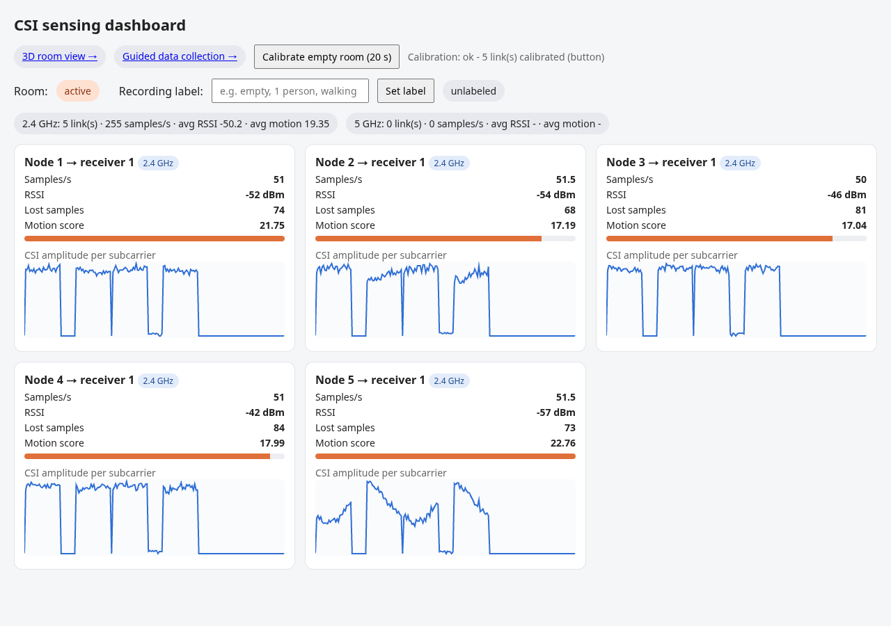

# WiFi CSI Room Sensing on home WiFi: seeing people with WiFi, no cameras

Cheap ESP32 boards send WiFi packets across a room. A person's body changes how those radio
waves travel, and the WiFi chip measures that as **Channel State Information (CSI)**. Two
receivers, one on **2.4 GHz** and one on **5 GHz**, send the CSI over your **normal home
WiFi** to a **laptop**, which works out roughly where people are and shows them in a
**slowly spinning 3D model of the room**.

This is the **`home-wifi-dual-band`** branch: no Raspberry Pi, no separate access point,
up to 10 transmitters, and an ESP32-C5 for 5 GHz. The Raspberry Pi version is the
[`flash-ready`](https://github.com/Rohan578/RSSI-CSI-Demo-/tree/flash-ready) branch
(see [Branches](#branches)).

[](docs/media/wifi-sensing-3d-demo.mp4)

*The 3D dashboard of this branch with the default room: 10 transmitters, the S3 and C5
receivers, and two people. **[Full 61 s video](docs/media/wifi-sensing-3d-demo.mp4)**.
This is a **simulation of the target behaviour**: the dashboard is real, but it was fed
ideal detections (every simulated person found, with realistic delay and wobble). The
current code usually shows two people as one; see [How accurate is it?](#how-accurate-is-it).*

[](docs/media/wifi-sensing-explainer.mp4)

*A 26 s top-down explainer of how it works: paths, calibration, a person crossing paths,
and home-WiFi interference being filtered out. **[Full video](docs/media/wifi-sensing-explainer.mp4)**
(animated simulation, square format for posts).*

---

## Contents

1. [Quick start](#quick-start)
2. [What this is (and isn't)](#what-this-is-and-isnt)
3. [How WiFi sensing works, in plain words](#how-wifi-sensing-works-in-plain-words)
4. [System overview](#system-overview)
5. [Hardware](#hardware)
6. [The room: zones, placement, room.json](#the-room-zones-placement-roomjson)
7. [Network design](#network-design)
8. [Router setup](#router-setup)
9. [ESP32 firmware](#esp32-firmware)
10. [Server software (the laptop)](#server-software-the-laptop)
11. [The web pages](#the-web-pages)
12. [Signal processing, step by step](#signal-processing-step-by-step)
13. [Finding people: geometry, tracker, AI model](#finding-people-geometry-tracker-ai-model)
14. [Collecting training data with volunteers](#collecting-training-data-with-volunteers)
15. [Training the AI model](#training-the-ai-model)
16. [Running the server](#running-the-server)
17. [HTTP API reference](#http-api-reference)
18. [Data formats](#data-formats)
19. [The simulator and the benchmark](#the-simulator-and-the-benchmark)
20. [How accurate is it?](#how-accurate-is-it)
21. [Configuration reference](#configuration-reference)
22. [Performance and resources](#performance-and-resources)
23. [Troubleshooting](#troubleshooting)
24. [Why not a pretrained "WiFi to 3D people" AI model?](#why-not-a-pretrained-wifi-to-3d-people-ai-model)
25. [Limitations and future work](#limitations-and-future-work)
26. [Branches](#branches)
27. [Repository layout](#repository-layout)
28. [Security notes](#security-notes)
29. [FAQ](#faq)
30. [Glossary](#glossary)
31. [Credits and licences](#credits-and-licences)

---

## Quick start

### Try it in 1 minute, no hardware needed

```bash
cd server
pip install -r requirements.txt          # flask, numpy, scikit-learn
python run_demo.py                       # server + simulated room (10 TX, S3, C5), auto-calibrated
python run_demo.py --interference        # ...with home-WiFi interference bursts
```

Open **http://localhost:5000/room**. It works the same on Windows, macOS and Linux
(`./demo.sh` does the same in bash). The simulated room starts empty for 25 s, which is
used as the calibration. Then 1, 2 and 3 people walk in and out, in a loop. The white
outlines are where the simulated people really are, so you can see the error. **Ctrl+C**
stops it; demo data goes to a temporary folder.

### The real thing, in order

| # | Step | Where | Details |
|---|------|-------|---------|
| 1 | Fix the router's 2.4 GHz channel (1, 6 or 11, 20 MHz) and 5 GHz channel (36–48) | router app / admin page | [Router setup](#router-setup) |
| 2 | Clone this branch, `pip install -r requirements.txt`, run `python server.py` | laptop on the home WiFi | [Running the server](#running-the-server) |
| 3 | Put the WiFi password into both receiver sketches (never commit it) | laptop | `tools/fill_wifi_password.sh`, or edit `config.h` |
| 4 | Flash the **S3** (`firmware/csi_receiver_24`), check it finds the server | Arduino IDE | [Bring-up order](#bring-up-order-do-not-skip) |
| 5 | Flash the **C5** (`firmware/csi_receiver_5g`), check `router | CSI/s ~50` | Arduino IDE | same |
| 6 | Flash **one** transmitter (`NODE_ID 1`), check it says `LOCKED`, then the others (2..10) | Arduino IDE | same |
| 7 | Place the boards, measure them into `server/room.json`, restart the server | the room | [The room](#the-room-zones-placement-roomjson) |
| 8 | Calibrate the empty room | `http://<laptop>:5000/room` | everyone out, press **Calibrate** |
| 9 | Record volunteers, train, reload | `/collect`, then `train_model.py` on the laptop | [Volunteers](#collecting-training-data-with-volunteers), [Training](#training-the-ai-model) |

---

## What this is (and isn't)

**It is:**

- A working pipeline: ESP32 transmitters → ESP32-S3 (2.4 GHz) and ESP32-C5 (5 GHz)
  receivers → your home WiFi → a laptop running a web dashboard with a 3D room view.
- Built to survive a **busy home network**: transmitters follow the router's channel by
  themselves, receivers find the laptop by themselves, and interference from other
  devices is filtered out instead of showing up as "ghost" people.
- Two ways of finding people:
  - a **geometric estimate** that works immediately;
  - an **AI model** (random forests) that you train on your own room with volunteers.
- A guided data-collection tool that tells volunteers where to stand, out loud, and
  labels the data by itself.
- A physics-style simulator and a **benchmark** that scores the real analysis code, so
  changes can be measured without hardware.

**It isn't:**

- **A camera.** It doesn't produce images, faces or skeletons. The 3D figures are symbols
  placed at the estimated positions.
- **Precise.** Expect "which part of the room" (about a 2 m square), not centimetres. With
  10 transmitters the typical error on the simulator is about 0.9 m.
- **Good at counting crowds yet.** One person is reliable on the simulator; two people are
  usually shown as one.
- **Plug-and-play across rooms.** Every room (and every furniture layout) needs its own
  calibration, and ideally its own training data.
- **Tested on the real boards yet.** Everything compiles and runs end to end on the
  simulator; the first hardware run is still to come. See [What is verified](#what-is-verified).

---

## How WiFi sensing works, in plain words

1. **A WiFi packet isn't sent on one frequency, but on many at once.** At 20 MHz width,
   802.11n uses 52 data **subcarriers**, each 312.5 kHz apart, like 52 thin radio
   stations side by side.
2. **The receiver measures each subcarrier.** Before decoding a packet, the WiFi chip
   compares the known training symbols at the start of the packet (the *LTF*, Long
   Training Field) with what actually arrived. The result is one complex number per
   subcarrier: how much that frequency was weakened (amplitude) and delayed (phase). That
   list is the **CSI**.
3. **Radio takes many paths.** The signal arrives straight from the transmitter, and also
   bounced off walls, the floor, the ceiling, furniture and people. These copies add up
   differently on each subcarrier, so the CSI has a characteristic jagged "shape".
4. **A body changes the paths.**
   - Standing on or near the direct line between two boards, it **blocks** that line, so
     the signal strength (RSSI) drops by a few dB.
   - Standing anywhere, it **adds and removes reflections**, so the CSI shape changes.
   - Moving, it makes the CSI **wobble** from packet to packet.
5. **Each transmitter → receiver pair is a "link" or "path".** Ten transmitters and the S3
   make ten links fanning across the room. Comparing which links change, and how, against
   the empty room tells us roughly where people are.
6. **Two bands see differently.**
   - **2.4 GHz** (12.5 cm wavelength) passes through bodies and furniture better, and is
     where the ten transmitter paths are. It's also crowded: phones, Bluetooth, microwaves
     and the neighbours' WiFi.
   - **5 GHz** (6 cm wavelength) reacts to smaller movements and is much quieter. The C5
     uses it to measure the **router → C5** path, as a second, independent view.
7. **Interference looks different from a person.** Another device's traffic disturbs
   *every* path of a receiver at the same moment. A person disturbs only the few paths
   near them. That difference is how the server filters interference out.

The ESP32's CSI has limits. It has one antenna, so no direction finding. The phase isn't
stable between packets. The amplitude gets rescaled by automatic gain control (AGC). This
project uses **amplitude and RSSI only**, with AGC removed by normalisation.

---

## System overview

```
                         THE ROOM (default: 20 x 20 ft basement)

   TX 3 . TX 4 ...... TX 5 ...... TX 6 ...... TX 7 . TX 8        10 transmitters (2.4 GHz)
    |  \     \          |          /          /     /  |          ESP-NOW broadcast,
   TX 2   \    \        |        /         /     /   TX 9         50 packets/s each,
    |  \    \    \      |      /        /     /    /   |          MAC 1a:00:00:00:00:<id>
   TX 1  \    \    \    |    /       /     /    /    TX 10
       \   \    \   \   |   /     /    /    /    /
         [ C5 ]       [ S3 receiver ]  measures CSI on every transmitter packet,
           ^  5 GHz      |  2.4 GHz     beacons "I'm on channel N" 5x/s
           |  pings      |
   home router (ORBI21) <+---- both receivers are normal clients of the home WiFi
           |
           |  UDP port 5005: batches of CSI samples      <- receivers
           |  UDP port 5006: "CSI-SERVER" announcements  -> receivers find the laptop
           v
   LAPTOP on the same WiFi (Windows / macOS / Linux)
     server.py ......... receives UDP, announces itself, logs CSV, serves the web (port 5000)
     analysis.py ....... 4x/s: scores links, removes interference, finds people
     localizer.py ...... room geometry, path-geometry estimate, tracker, AI model
     guided.py ......... volunteer schedule + automatic labels
     train_model.py .... learns zones and head count from recorded volunteer sessions
           |
           v
   Browser (the laptop itself, or any phone / TV / laptop on the home WiFi)
     /room 3D view  .  /collect volunteer guide  .  / link dashboard
```

**The data path, timed:**

1. Each transmitter sends a tiny 12-byte ESP-NOW broadcast every 20 ms (±2 ms jitter).
2. The S3's WiFi driver measures CSI on each one, within microseconds. The C5 measures CSI
   on the router's replies to its pings, 50 per second.
3. Each receiver packs several samples into one UDP packet (flushed at least every 50 ms)
   and sends it to the laptop through the home router.
4. The server stores each sample in a per-link ring buffer as it arrives.
5. Every 250 ms, the analysis thread looks at the last 1 s of every link, removes the
   disturbance shared by all of a receiver's links, and decides where people are.
6. The browser polls every 250 ms and animates smoothly between updates.

---

## Hardware

| Qty | Board | Role | Sketch | Arduino board setting |
|---|---|---|---|---|
| up to 10 | ESP32 DevKit / ESP32-C3 / **ESP32-C6 SuperMini** / ESP32-C5 | **Transmitters**, `NODE_ID` 1–10, 2.4 GHz | `firmware/csi_transmitter` | ESP32 Dev Module / ESP32C3 / ESP32C6 / ESP32C5 Dev Module |
| 1 | **ESP32-S3**: Seeed **XIAO ESP32S3** with its U.FL antenna (a dipole is better) | **2.4 GHz receiver**, `RECEIVER_ID 1` | `firmware/csi_receiver_24` | XIAO_ESP32S3 (or ESP32S3 Dev Module) |
| 1 | **ESP32-C5 DevKit, 4 MB flash** | **5 GHz receiver**, `RECEIVER_ID 2` | `firmware/csi_receiver_5g` | ESP32C5 Dev Module, Flash 4MB |
| (optional) | another ESP32-C6 or S3 | **2nd 2.4 GHz receiver**, `RECEIVER_ID 3`. An experiment: it didn't improve the simulator benchmark | `firmware/csi_receiver_24` | ESP32C6 Dev Module |
| 1 | Laptop / PC on the home WiFi | Runs `server/server.py` | – | Python 3.9+ |
| – | Your home router | The WiFi, and the 5 GHz "transmitter" for the C5 | – | – |
| – | Stands or shelves at about 1 m | Hold every board at the same height | – | – |
| – | Masking tape | 3 × 3 floor grid for volunteers | – | Squares about 6 ft 8 in (2.03 m) |

**Which board where:**

- **The receiver is where antenna quality matters most.** The XIAO S3 takes an external
  antenna and has two cores, so it keeps up with 10 × 50 packets/s while also sending
  over WiFi. **Attach the antenna** (the XIAO has none built in) and mount it vertically.
- **Transmitters only send a tiny packet 50 times a second,** so any board works. C6
  SuperMinis are cheap and small.
- **The C5 is the only board here that does 5 GHz.** Its sketch uses about a third of the
  4 MB flash.

**Board roles:**

- **Transmitters never join the WiFi** and need no password. They broadcast ESP-NOW
  packets from the fixed MAC `1a:00:00:00:00:<NODE_ID>` on the channel where they hear a
  receiver's beacon.
- **The S3 joins the home WiFi on 2.4 GHz** (so it can send UDP to the laptop) and listens
  in promiscuous mode at the same time. It measures CSI only on packets from MACs
  starting `1a:00:00:00:00`.
- **The C5 joins the home WiFi on 5 GHz**, pings the router 50 times a second, and
  measures CSI on the router's replies. In the dashboard the router is "node 0".

---

## The room: zones, placement, room.json

### Default layout

`server/room.json` (a 20 × 20 ft room, 6.10 m):

```
                         north wall
    TX 3 (0.25,5.20)   TX 4 (0.90)  TX 5 (2.25)  TX 6 (3.85)  TX 7 (5.20)   all at y = 5.85
          +---------------+---------------+---------------+   TX 8 (5.85,5.20)
          |      A3       |      B3       |      C3       |
    TX 2  +---------------+---------------+---------------+   TX 9 (5.85,3.40)
   (0.25, |      A2       |      B2       |      C2       |
    3.40) +---------------+---------------+---------------+   TX 10 (5.85,1.60)
    TX 1  |      A1       |      B1       |      C1       |
   (0.25, +---------------+---------------+---------------+
    1.60)   C5 (0.60,0.25)     S3 receiver (3.05, 0.25)
                         south wall          (home router: outside the room, (5.5, 7.5))
```

- **Coordinates are metres** from the south-west floor corner: x points east, y north,
  z up. 20 ft = 6.10 m.
- **"South"** is simply the wall with the S3; pick it and stay consistent.
- **Zones:** columns are letters (A = west), rows are numbers (1 = south). The grid size
  is set by `"zones": {"cols": 3, "rows": 3}`.

### Why this placement

- With **one 2.4 GHz receiver**, every link ends at the S3, so the links fan out from it
  like spokes. Putting the S3 in the middle of one wall, with transmitters spread over the
  other three walls, makes the spokes cover the whole floor.
- **More transmitters = more spokes.** Going from 5 to 10 cut the typical error on the
  simulator from 1.35 m to 0.9 m. **Fewer works too:** with 5, remove transmitters 6–10
  from `room.json` and spread the rest around the walls.
- **The C5 measures the router → C5 path.** Put it where that path crosses the room if
  you can, for example on the wall *opposite* the router's direction.
- **All boards at the same height, about 1 m (chest height),** so the direct paths pass
  through people's torsos.

### Placement rules

1. **Measure where each board really is** (±10 cm) and edit `room.json`. Then restart
   `server.py` (or `POST /api/model/reload`).
2. **Never move, rotate or swap a board** once you've recorded training data. If you
   must, re-calibrate and record new training data.
3. **Label each board with its `NODE_ID`**, and make sure `room.json`'s `transmitters`
   keys match.
4. **Mount the receivers' antennas vertically and fix the cables.** A moving antenna
   changes the CSI.
5. **Keep the doors the same** (open or closed) during calibration, recording and use.

### room.json fields

| Field | Meaning |
|---|---|
| `name` | Shown in the 3D view's title |
| `width`, `depth`, `height` | Room size in metres (x, y, z) |
| `zones.cols`, `zones.rows` | Floor grid used by `/collect` and the AI model |
| `receivers.<id>` | `x, y, z, label, band` (`"2.4"` or `"5"`). The id is the receiver's `RECEIVER_ID`. `"source": "access_point"` = this receiver measures the router (the C5). `"enabled": false` = not in use (hidden, ignored) |
| `transmitters.<id>` | `x, y, z, label`. The id is the transmitter's `NODE_ID` (1..10). Remove entries for boards you don't have |
| `access_point` | Your router: `x, y, z, label, in_room`. Only if `in_room` is `true` does its path to the C5 count for positions; otherwise it's used by the AI model and the interference check only |
| `furniture` | Optional list of `{name, x, y, w, d, h}` boxes, drawn in 3D |

A link whose transmitter or receiver isn't in `room.json` still shows on the dashboards,
but can't be used for positions.

---

## Network design

Everything runs on one home WiFi network. The layout tested in the house is **ORBI21**
(a Netgear Orbi mesh).

| Device | On the home WiFi | How |
|---|---|---|
| Laptop | its normal connection, **must be on 172.16.0.x** on ORBI21 | Runs `server.py`, which **announces itself** once a second on UDP 5006 |
| ESP32-S3 receiver | **fixed 172.16.0.240**, gateway 172.16.0.1, 2.4 GHz | Finds the laptop from the announcements, at start-up and whenever it changes |
| ESP32-C5 receiver | **fixed 172.16.0.241**, gateway 172.16.0.1, 5 GHz | The same; pings the gateway (the router) for CSI |
| 2nd 2.4 GHz receiver (optional) | fixed 172.16.0.242 | The same as the S3, on the **same mesh box** (`WIFI_BSSID`) |
| Transmitters | not on the network | Lock onto the S3's channel from its beacons |

### How the receivers find the laptop

- `server.py` broadcasts the text `CSI-SERVER v1 port=5005` once a second, to
  `255.255.255.255` and to the subnet's broadcast address, on **UDP port 5006**.
- Each receiver listens on 5006. The sender's IP address becomes its server; the
  `port=` value is where it sends CSI. If the laptop's IP changes, the receivers follow.
- Until a server is known, samples are dropped and counted as `no-server drops`, and the
  status LED blinks fast.
- **Fallbacks:** `SERVER_IP` (a fixed address) or `SERVER_HOST` (an mDNS name such as
  `my-laptop`) in the receiver's `config.h`. Use them only if broadcasts are blocked.

### ORBI21 specifics (measured 2026-11-06 on the flash-ready branch)

- **Two DHCP servers.** The Orbi router (`172.16.0.1`) offers 172.16.0.x. A second
  device (`172.16.0.37`, MAC `d0:c5:d3:60:1e:23`) offers 172.27.35.x behind its own NAT,
  which lost about 90% of the S3's packets. So:
  - both receivers use **fixed 172.16.0.x addresses**;
  - **the laptop must be on 172.16.0.x** too. Check with `ipconfig` (Windows) or
    `ip a` / `ifconfig`. If it got 172.27.35.x, reconnect, or give it a fixed address.

  The real fix is to find that device in the Orbi app (by its MAC) and stop it handing
  out addresses.
- **Orbi is a mesh:** several boxes share the name. Each receiver prints the box (BSSID)
  it joined. **Two 2.4 GHz receivers must be on the same box** so they share a channel:
  put the same `WIFI_BSSID` in both. The main router's 2.4 GHz BSSID was
  `0E:02:8E:9B:DA:18`.
- **2.4 GHz channel 1** on 2026-11-06.

### Rules on a home network

- **The laptop and the receivers must be on the same subnet**, and the network must not
  block device-to-device traffic: no guest network, no "client isolation" / "AP isolation".
- **Windows:** the home WiFi must be a **Private** network, and Python allowed through the
  firewall on Private networks. Otherwise incoming UDP is silently dropped.
- **WiFi passwords never go into git** (see [Security notes](#security-notes)).
- **A home network is busier** than a dedicated one. The common-mode removal handles
  short bursts; constant heavy traffic on the same channel still costs accuracy. The
  ESP-NOW broadcasts add a few percent of airtime.
- **The dashboard has no login:** anyone on the home WiFi can open it.

### Network ports

| Port | Direction | What |
|---|---|---|
| UDP 5005 | receivers → laptop | CSI batches |
| UDP 5006 | laptop → broadcast | Server announcements |
| TCP 5000 | browsers → laptop | Web pages and API |

---

## Router setup

The router replaces the dedicated access point of the Pi version. **Do this first.**

| Setting | 2.4 GHz | 5 GHz |
|---|---|---|
| Channel | **Fixed** to **1, 6 or 11**, whichever is quietest (a WiFi analyzer app shows this) | **Fixed** to **36, 40, 44 or 48** if the router allows it. **Avoid 52–144 (DFS):** the router may jump off them for radar |
| Width | **20 MHz** | Anything (the C5 always uses 20 MHz) |
| Security | WPA2, or WPA2/WPA3 mixed (not WPA3-only) | same |
| Other | Not a guest network. Client / AP isolation off | same |

- **Why fix the channel?** Transmitters follow the S3's beacons, so a channel change no
  longer silences them for good. But each change still costs about 10–15 s of data while
  they search, and the calibration was made on the old channel.
- **After a channel change:** calibrate again. If the 2.4 GHz channel moved permanently,
  retrain the AI model too.
- **If the router has one name for both bands,** the S3 joins on 2.4 GHz and the C5 on
  5 GHz by themselves (the sketches force the band). If it splits them (e.g. `ORBI21-5G`),
  put the 5 GHz name in the C5's `WIFI_SSID`.

---

## ESP32 firmware

All the firmware is in `firmware/`. It is an Arduino IDE project based on Espressif's
`esp-csi` examples (`csi_send`, `csi_recv`, `csi_recv_router`).

### Arduino IDE setup (once)

1. **File → Preferences → Additional boards manager URLs:**
   `https://espressif.github.io/arduino-esp32/package_esp32_index.json`
2. **Boards Manager:** install "esp32 by Espressif Systems" **3.3.0 or newer** (the C5 and
   the CSI calls need it). Every sketch was compiled on **3.3.12** with zero warnings.

| Board | Tools → Board | USB CDC On Boot |
|---|---|---|
| ESP32 DevKit / WROOM-32 | ESP32 Dev Module | (n/a) |
| ESP32-C3 SuperMini | ESP32C3 Dev Module | **Enabled** |
| ESP32-C6 SuperMini | ESP32C6 Dev Module | **Enabled** |
| Seeed XIAO ESP32S3 | XIAO_ESP32S3 | **Enabled** |
| ESP32-C5 DevKit | ESP32C5 Dev Module, **Flash Size 4MB** | Enabled on the native USB port, Disabled on the UART port |

Open the `.ino` file; its `config.h`, `csi_packet.h` and `espnow_packet.h` open as tabs
next to it. The Serial Monitor runs at **115200 baud**. If an upload won't start, hold
**BOOT** while plugging in.

### Sketches

| Folder | Runs on | Does |
|---|---|---|
| `csi_transmitter/` | ESP32, C3, C6, C5 | Finds the S3's channel from its beacons, then broadcasts ESP-NOW at 50 Hz (±2 ms jitter), 802.11n MCS0, 20 MHz, fixed TX power, MAC `1a:00:00:00:00:<NODE_ID>` |
| `csi_receiver_24/` | ESP32-S3 (also C6, ESP32, C3) | Joins the home WiFi on 2.4 GHz, captures CSI from the transmitters, beacons its channel, sends UDP batches to the laptop it discovered |
| `csi_receiver_5g/` | ESP32-C5 | Joins the home WiFi on **5 GHz**, pings the router 50×/s and captures CSI on its replies (node 0). With `USE_5GHZ 0` it works as a 2.4 GHz receiver instead |

`espnow_packet.h` is identical in all three folders, and `csi_packet.h` in both receivers.
Keep them in sync if you change one.

### How a transmitter finds its channel

1. **Search** (`SEARCH` in the Serial Monitor, fast-blinking LED): listen on each 2.4 GHz
   channel for `BEACON_DWELL_MS` (450 ms) for a receiver beacon. A beacon only counts if
   the channel it announces is the channel it was heard on.
2. **Locked** (`LOCKED`, slow blink): send on that channel. If a beacon announces a
   different channel (the router moved), switch to it at once.
3. **Lost:** no beacon for `BEACON_LOST_MS` (10 s) → search again.
4. **Fallback** (`FALLBACK`, double blink): if no receiver is heard at all, scan for the
   router by name (`AUTO_CHANNEL_SSID`) and use its 2.4 GHz channel, else `WIFI_CHANNEL`.
   It keeps looking for beacons every `SEARCH_RETRY_MS` (30 s).

Each transmitter also waits a start offset based on its `NODE_ID`, so ten boards powered
together don't start in the same time slot.

### How the receivers work

- **Joining the WiFi:** fixed IP if `STATIC_IP` is set (DNS = the gateway), optional
  `WIFI_BSSID` pin with a fallback to any box after a while, power saving off. The
  receiver refuses to start while `WIFI_PASSWORD` is still the placeholder.
- **CSI capture:** a callback copies each wanted sample into a queue; `loop()` packs
  samples into UDP batches of up to 1400 bytes and sends one at least every 50 ms.
- **The S3 sends only the 128-byte LLTF block** (`CSI_SEND_BYTES 128`): that's all the
  server uses, and it cuts uplink traffic to a third. (On a C6 it sends the full CSI,
  because its layout differs.)
- **Beacons:** the S3 broadcasts an 8-byte `rx_beacon_t` 5 times a second (only 2.4 GHz
  receivers do).
- **The C5:** sets 5 GHz-only band mode after `WiFi.mode()`, forces HT20, and keeps only
  CSI from frames sent **by the router to itself**. It re-reads the router's MAC after
  every reconnect, because a mesh can hand it to another box.
- **USB serial never stalls a receiver** (`Serial.setTxTimeoutMs(0)`), so it runs fine
  without a computer reading the Serial Monitor.

### What changed vs. `flash-ready`

| Problem on `flash-ready` | Fix in this branch | Where |
|---|---|---|
| Transmitters copied the router's channel once at power-up. The Orbi changes its 2.4 GHz channel by itself, and then **all transmitters went silent** until power-cycled | Receiver **channel beacons**; transmitters lock on, follow, and search again by themselves | all three sketches |
| Up to 10 transmitters on separate clocks can drift into the same time slot and keep colliding | **±2 ms jitter** per packet, plus a start offset per `NODE_ID` | `csi_transmitter` |
| The S3 sent 384 bytes per sample, but the server uses only 128 | Sends **only the LLTF block**; queue grew 64 → 128 for 10 nodes | `csi_receiver_24` |
| The server's address had to be typed in (or found as `csi-pi.local`) | The server **announces itself**; receivers follow it | `server.py`, both receivers |
| The C5 had no fixed IP, no BSSID pin and no serial-stall fix | Same home-network handling as the S3, plus router MAC refresh after roaming | `csi_receiver_5g` |
| The CSI byte order was only *checked* (S3 order) | **Detected per link**; the server switches to the other common order if that one fits (C5/C6). Training does the same | `csi_features.py`, `server.py`, `train_model.py` |
| `demo.sh` needs bash | `run_demo.py` works on Windows / macOS / Linux | `server/` |

### Settings, by file

**`csi_transmitter/config.h`**

| Setting | Value | Meaning |
|---|---|---|
| `NODE_ID` | **1 to 10, different on each board** | Becomes the last MAC byte and the dashboard's "TX n". Must match `room.json` |
| `FOLLOW_RECEIVER` | 1 | Follow the receivers' beacons (0 = fixed channel, like flash-ready) |
| `AUTO_CHANNEL_SSID` | `"ORBI21"` | Fallback: copy this network's 2.4 GHz channel. `""` = skip |
| `WIFI_CHANNEL` | 1 | Last-resort fallback channel |
| `BEACON_DWELL_MS` / `BEACON_LOST_MS` / `SEARCH_RETRY_MS` | 450 / 10000 / 30000 | Search timing |
| `SEND_RATE_HZ` | 50 | **Same on every board** (use 40 if 10 nodes are heavy for your network) |
| `SEND_JITTER_US` | 2000 | Random ± timing per packet |
| `TX_POWER_DBM` | 15 | **Same on every board** |

**`csi_receiver_24/config.h`** (the S3)

| Setting | Value | Meaning |
|---|---|---|
| `WIFI_SSID` / `WIFI_PASSWORD` | `"ORBI21"` / `"__WIFI_PASSWORD__"` | Fill in the password locally before flashing. Never commit it |
| `WIFI_BSSID` | `""` | Join one specific mesh box, or `""` = any |
| `STATIC_IP` / `STATIC_GATEWAY` / `STATIC_SUBNET` | `"172.16.0.240"` / `"172.16.0.1"` / `"255.255.255.0"` | Fixed address. `""` = DHCP on a normal home network |
| `SERVER_IP` / `SERVER_HOST` | `""` / `""` | Only if announcements can't reach the receiver |
| `SERVER_PORT` / `DISCOVERY_PORT` | 5005 / 5006 | Must match `server.py` |
| `RECEIVER_ID` | 1 | Must match `room.json` → `receivers` |
| `BEACON_RATE_HZ` | 5 | Channel beacons for the transmitters (0 = off) |
| `CSI_SEND_BYTES` | 128 | Bytes of CSI sent per sample (0 = all) |
| `NODE_MAC_PREFIX` | `1a:00:00:00:00` | Which senders count as transmitters |
| `MAX_UDP_PAYLOAD`, `BATCH_FLUSH_MS`, `CSI_QUEUE_LENGTH` | 1400, 50, 128 | Batching |

**`csi_receiver_5g/config.h`** (the C5)

| Setting | Value | Meaning |
|---|---|---|
| `USE_5GHZ` | 1 | 0 = work as a 2.4 GHz receiver instead |
| `WIFI_SSID` / `WIFI_PASSWORD` | `"ORBI21"` / placeholder | Use the 5 GHz name if your router splits the bands |
| `STATIC_IP` | `"172.16.0.241"` | Gateway and subnet as the S3 |
| `RECEIVER_ID` | 2 | Must match `room.json` |
| `CSI_FROM_ACCESS_POINT` / `PING_RATE_HZ` / `PING_TARGET_IP` | 1 / 50 / `""` | Ping the router (`""` = the gateway) and measure its replies |
| `CSI_FROM_TRANSMITTERS` | 1 | Also measure transmitters (only matters with `USE_5GHZ 0`) |
| `CSI_QUEUE_LENGTH` | 96 | Batching as the S3 |

### Bring-up order (do not skip)

1. Start `server.py` on the laptop first; receivers look for it at start-up.
2. Flash the **S3**. Its Serial Monitor should show the WiFi channel, the mesh box it
   joined, and `[SERVER] Laptop server found at ...`.
3. Flash the **C5**. It should show `BAND: 5 GHz` and `router | CSI/s ~50`.
4. Flash **one** transmitter (`NODE_ID 1`). It should say
   `Receiver heard on channel N - sending there`, then `LOCKED`. On the S3,
   `node 1 | CSI/s ~50` appears.
5. Only then flash the other transmitters, **changing `NODE_ID` before every upload**.

### What each Serial Monitor should say

**Transmitter (every 5 s):**
```
node 4 | LOCKED ch 1 | pkt/s 50.0 | receivers [1] | beacon age 120 ms | busy 0 | errors 0 | channel changes 1
```

**S3 (every 5 s):**
```
[STATS] WiFi OK ch 1 | server 172.16.0.75 (announcement) | CSI 25031 | sent 25010 in 2780 UDP | queue full 0 | UDP errors 0 | no-server drops 0 | beacons 250
  node   1 | CSI/s  49.6 | heard/s  49.6 | RSSI  -52 dBm | CSI 128 bytes
  ... one line per transmitter ...
```

**C5 (every 5 s):**
```
[STATS] 5 GHz ch 36 | WiFi OK | server 172.16.0.75 (announcement) | CSI 2504 | ...
  router    | CSI/s  49.8 | pings ok/s  49.8 | RSSI  -58 dBm | CSI ... bytes | timeouts 0
```

---

## Server software (the laptop)

Everything is in `server/`. It is pure Python plus static web files, and runs on Windows,
macOS and Linux.

| File | What it does |
|---|---|
| `server.py` | Entry point. UDP listener (thread), **discovery announcer** (thread), CSV logger, Flask web server: all pages and APIs. Detects each link's CSI byte layout |
| `analysis.py` | The live engine (thread, 4 updates/s): calibration jobs, per-link scoring, **common-mode removal and the interference gate**, localisation, tracking, AI inference, simulator scoring, the `/api/state` snapshot |
| `localizer.py` | `Room` (geometry, zones, enabled receivers, router), `GeometricLocalizer`, per-band `fade_weights`, `Tracker`, `ZoneModel` |
| `csi_features.py` | CSI bytes → amplitudes → normalised → **Hampel-filtered** window features. **Shared by live and training.** Includes the byte-layout detection |
| `guided.py` | `GuidedSession`: the volunteer schedule, current step, CSV labels |
| `train_model.py` | Offline: reads guided-session CSVs, trains and evaluates, saves `models/zone_model.joblib` + `.json` |
| `sim_room.py` | Simulated room: several receivers, the router link, interference (see [The simulator](#the-simulator-and-the-benchmark)) |
| `benchmark.py` | Scores the real analysis code on fixed simulator scenarios; can also write simulated guided sessions |
| `bench/` | Room layouts used by the benchmark (5 or 10 transmitters, with/without C5, 2nd receiver) |
| `run_demo.py`, `demo.sh` | Server + simulator + auto-calibration, for trying everything without hardware |
| `fake_receiver.py`, `compare_bands.py` | A minimal fake receiver, and a 2.4 vs 5 GHz comparison of recordings |
| `room.json` | Room size, board and router positions |
| `static/room.html`, `static/room.js` | The 3D view |
| `static/collect.html` | The volunteer guide |
| `static/vendor/three/` | three.js 0.186.1 (MIT), bundled so nothing loads from the internet |

**Threads:** the UDP listener parses batches, updates per-link stats and ring buffers, and
writes the CSV; the announcer broadcasts once a second; the analysis loop runs every
250 ms; Flask serves the requests. They share the `links` dict under `links_lock`. Each
link keeps the last **60 s** of normalised amplitudes.

**Python dependencies:** Flask ≥ 2.2, numpy ≥ 1.24, scikit-learn ≥ 1.2 (it brings joblib).
`pip install -r requirements.txt` installs them.

---

## The web pages

All served by the laptop on port 5000: `http://localhost:5000` on the laptop itself, or
`http://<laptop IP>:5000` from any phone, TV or laptop on the home WiFi. `server.py`
prints the exact address at start-up.

### `/room`: the 3D view



| Element | Meaning |
|---|---|
| Slow spin | About 2 minutes per turn. Drag to look around; spinning resumes 8 s after you let go. The walls nearest the camera fade, doll-house style |
| Boards | Small boxes on poles at their `room.json` positions, labelled (TX n, "S3 receiver (2.4 GHz)", "C5 receiver (5 GHz)"). The router is drawn only if `in_room` is true |
| Radio paths | One line per link. **Brighter and thicker = more disturbed** (a body near that path). Dots travel along live paths; offline paths go dim |
| Floor glow (violet) | Where someone probably is: the geometric likelihood, blended with the AI model's zone probabilities in model mode |
| People | A figure per detected person, in categorical colours (Person 1 blue, 2 orange, 3 green), with a pulsing floor ring and a label (zone, moving/still) |
| Top-left panel | Head count; mode chip (**Path geometry** or **AI model**); calibration chip; "n/n paths live"; **air chip** ("air quiet", "WiFi interference - filtering", or "WiFi interference (5 GHz confirms)"); room activity; list of people |
| Top-right panel | Per-path disturbance bars and packet rates (`TX n → R1`, `Router → R2 (5G)`), legend, AI model status |
| Bottom bar | Toggles: Spin, Floor glow, Paths, Labels, True positions (simulator only); links to the other pages |
| Banner | The one thing to fix first: no data, CSI in an unexpected format, not calibrated, busy calibration, or calibrating |
| Simulator check | Only with `sim_room.py`: true positions as white outlines, plus the last minute's average error and count accuracy |

### `/collect`: the volunteer guide



- **Setup form:** volunteers at once (1–3), seconds per square, seconds to walk, rounds,
  empty-room seconds, stand and/or walk, and "read instructions aloud".
- **During a session:** a huge instruction with a countdown, a floor map with each
  volunteer's colour badge, a preview of the next square, progress and a stop button.
- **Speech synthesis** reads the instructions ("Blue, go to B 2"), with beeps and 3-2-1
  ticks.
- **Data watch:** a warning if paths are missing. Recording with a dead transmitter
  wastes the session.

### `/`: the link dashboard



Per-link cards (samples/s, RSSI, lost samples, motion score, live CSI amplitude), a
2.4 GHz vs 5 GHz comparison, a free-form recording label, a calibrate button, and links to
`/room` and `/collect`.

---

## Signal processing, step by step

All of this lives in `csi_features.py` and `analysis.py`.

### 1. Getting amplitudes from the bytes

- Every packet type has the **LLTF block, the first 128 bytes**, so only that block is
  used. Features then don't change when a packet arrives as 802.11g instead of 802.11n.
  (That's also why the S3 sends only those 128 bytes.)
- The bytes are signed int8 pairs `[imag, real]` per subcarrier.
- The **52 data subcarriers** −26..−1 and +1..+26 are kept; DC and the guards are dropped.
- Amplitude = √(real² + imag²). When `first_word_invalid` is set, subcarrier +1 copies +2.

### 2. Byte-layout detection

Different chips and firmware order the subcarriers differently. Two layouts are known:

| Layout | Order | Typical for |
|---|---|---|
| `esp32` | `0..31, -32..-1` | ESP32, S3 |
| `linear` | `-32..31` | some C5 / C6 firmware |

Real 802.11 CSI has **nothing in the guard subcarriers**. For the first 200 samples of
every link, the server computes `guard amplitude / data amplitude` for each layout and
picks the one whose median is below **0.25**. If it switches, it logs
`CSI uses the 'linear' byte layout - switched`. If neither fits, it logs
`CSI layout doesn't match any known one` and `/room` shows a banner. `train_model.py`
applies the same rule per link, so training reads the data exactly like the live server.

### 3. Removing automatic gain control

The ESP32's AGC rescales the whole CSI vector in steps. Every sample is therefore
**divided by its own mean amplitude**. Absolute strength is kept separately as **RSSI**,
which the radio measures before AGC.

### 4. Hampel filter (new)

On a busy home network, some packets overlap with other devices' traffic and come out with
a few subcarriers badly distorted. One such packet looks like a big "wobble". Per window
and per subcarrier, values more than **3 MADs** from the median are replaced by the median
(`hampel()`, MAD floor 0.02). A moving person changes the CSI smoothly from packet to
packet and survives this filter. It is applied to the window statistics and to the
calibration baseline.

### 5. Window statistics (1 s per link, every 250 ms)

*m* = mean over time per subcarrier, *s* = standard deviation over time per subcarrier.

| Quantity | Formula | Means |
|---|---|---|
| motion | 100 · mean(*s*) / mean(*m*) | Overall wobble, relative to the overall level |
| deviation | 100 · ‖*m* − *b*‖ / ‖*b*‖, *b* = empty-room mean | Shape change vs. the empty room. Catches people **standing still** |
| ΔRSSI | mean RSSI − empty-room RSSI (dB) | Power change; the **local** cue |
| RSSI std | std of RSSI in the window (dB) | Power wobble; local-ish movement cue |

### 6. Calibration (empty-room baseline)

You record ~20 s of the empty room, with the button on `/room` or `/`, or automatically
during the first step of every guided session. Per link, the baseline stores the
empty-room mean and std per subcarrier, and the window-to-window noise of deviation,
motion, RSSI mean and RSSI std as robust statistics (median and 1.4826 × MAD), with floors
so a perfectly quiet link doesn't give infinite z-scores. If any link looked too busy,
the calibration is flagged "looked busy": someone was probably still in the room.

It is saved to `data/calibration.json`, reloaded at start-up, and refused if
`FEATURE_VERSION` changed (it is **2** on this branch).

### 7. From numbers to 0..1 "disturbance" scores

With *z* = (value − μ)/σ: `disturbance(value) = 1 - exp( -max(0, z - z0) / scale )`.

| Score | Built from | Used for |
|---|---|---|
| `presence` | max of shape and wobble scores. **Not local:** a person anywhere changes every link's reflections | Room activity; "moving" flag; the 5 GHz confirmation |
| `rssi_change` | Power change beyond 1 dB plus twice the jitter, either direction | Localisation |
| RSSI wobble | RSSI std score | Localisation |
| **`disturbance`** | max(rssi_change, RSSI wobble) × fade weight | The geometric estimate and the path brightness in 3D |

### 8. Common-mode removal (new)

For each receiver and band with at least **4 links** (`COMMON_MODE_MIN_LINKS`):

1. take the **median `disturbance`** over its links: the part they all share;
2. **subtract it** from every link (the original is kept as `raw_disturbance`);
3. if that shared part is above **0.25** (`INTERFERENCE_LEVEL`), report it under
   `interference` in `/api/state`, and the 3D view's chip says "WiFi interference -
   filtering".

A person near a few paths raises those paths, not the median, so they survive. A burst of
interference raises all of them together and is removed.

### 9. The interference gate (new)

While any 2.4 GHz receiver reports interference, the tracker **won't start new people**
(`new_people_paused` in `/api/state`). People already shown keep being tracked. The
exception: if the **5 GHz link's `presence` is at least 0.30** (`FIVE_GHZ_CONFIRM`), the
gate opens, because 5 GHz barely feels 2.4 GHz interference, so movement there is real.

### 10. Fade weighting

A link "in a deep fade" is much weaker than its length predicts and jumps around whenever
*anyone* moves *anywhere*. A free-space fit over the calibration RSSIs gives each link a
weight between 0.25 and 1 (9 dB or more below the model counts at a quarter). On this
branch the fit is done **per band**, so the 5 GHz link isn't compared with 2.4 GHz ones.
`/api/state` shows each weight as `reliability`.

---

## Finding people: geometry, tracker, AI model

### Geometric estimate (`GeometricLocalizer`, works without training)

1. **Grid:** the floor is cut into 10 cm cells, excluding 30 cm along the walls.
2. **Influence maps:** each link is a straight segment, transmitter → receiver (the router
   → C5 path only if the router is `in_room`). For every cell, the expected disturbance
   if one person stood there is `exp(-(distance to the segment / 0.55 m)^2)`.
3. **Pattern matching:** the measured disturbance vector is compared with each cell's
   expected pattern by cosine similarity. The likelihood map **is the floor glow**.
4. **One person:** the strongest cell is a candidate if its fitted amount is ≥ **0.22**.
   The person is placed at the likelihood-weighted centroid of nearby strong cells.
5. **More people:** the first person's share is subtracted and the search repeats. A 2nd
   or 3rd person needs ≥ **0.70** and ≥ **2 m** from people already found. That is strict
   on purpose: with one receiver, leftovers easily become ghosts.

### Tracker (`Tracker`)

- **Gating:** detections continue existing people within **1.6 m**, with smoothing (30%
  per update).
- **Confirmation:** a new person is shown after **2** consecutive updates; a 2nd or 3rd
  needs **5**. **No new person at all while the interference gate is closed.**
- **Removal:** after **8** missed updates (2 s).
- **Numbering:** the lowest free number, so one person in the room is always "Person 1".

### AI model (`ZoneModel`, after training)

**Features.** For every link, 30 numbers per 1 s window, all relative to the empty room:
13 shape-change groups, 13 wobble groups, and deviation, motion, ΔRSSI, RSSI std. Plus a
"link present" flag per link. **Every link counts, including the C5's router link
(`r2-t0-5`).** A missing link gives zeros, so the model degrades instead of crashing.

**Two random forests** (scikit-learn, 300 trees each): a **zone model** (for each square
A1..C3, the probability someone is there) and a **head-count model** (P(0)..P(3)).

**Decision:** smooth the head-count probabilities, take the most likely count *N*, and
show the **N most likely squares**, with a little stickiness so they don't flicker. Each
person's exact point comes from the geometric likelihood map inside their square.

---

## Collecting training data with volunteers

**The complete briefing, floor-tape plan and session plan are in
[`docs/VOLUNTEERS.md`](docs/VOLUNTEERS.md).**

### What to tell the volunteers

> Don't touch or move the boards. Phone in airplane mode, no backpacks. You're Blue,
> Orange or Green: the screen and voice say which taped square to go to. "Stand still" is
> arms relaxed, no talking. "Walk around inside your square" is slowly, inside the tape.
> "Everyone out" means leave the room completely until called back.

### How a guided session works (`guided.py`)

1. **Empty room** (default 30 s): everyone outside. This step **re-calibrates
   automatically**.
2. **For each round × each activity** (stand / walk), every volunteer visits every square
   once, in random order, offset so nobody shares a square.
3. **Each step is a walk phase (6 s) then a hold phase (20 s).**
4. **Empty room again** at the end, to check for drift.

Every CSI row logged during a session carries a label like
`guided;sess=s20261107-1400;step=4;phase=hold;act=stand;occ=A2+C1;n=2`. Only `hold`
phases are used for training. Each session's schedule is saved to
`data/sessions/<id>.json`.

### Suggested plan (about 1.5 hours)

| # | In the room | Rounds | Activity | About |
|---|---|---|---|---|
| 1 | 1 volunteer (A) | 2 | stand + walk | 17 min |
| 2 | 1 volunteer (B, a different build) | 2 | stand + walk | 17 min |
| 3 | 2 (A + B) | 2 | stand | 9 min |
| 4 | 3 (A + B + C) | 2 | stand | 9 min |
| 5 | 1 (C), the **held-out test** | 1 | stand + walk | 9 min |

**Sessions 3 and 4 matter most for counting people.** Without 2- and 3-person data, the
model can't learn to count them.

---

## Training the AI model

Run it **on the same computer that runs the server**: a saved model only loads with the
scikit-learn version that trained it, and the server checks this.

```bash
cd server
python train_model.py --list                     # sessions found in data/
python train_model.py --test-session <id>        # train on the others, test on this one
python train_model.py                            # final model from all sessions
```

Then restart `server.py`, or load the model without a restart:

```bash
curl -X POST http://localhost:5000/api/model/reload
# Windows without curl:
python -c "import urllib.request as u; u.urlopen(u.Request('http://localhost:5000/api/model/reload', method='POST'))"
```

`/room` then switches to "AI model".

**What it does:**

1. Reads all `data/csi_*.csv` files, keeps rows with guided labels, and **detects each
   link's byte layout** like the live server.
2. Builds each session's baseline from its own first empty step.
3. Cuts each hold step into **1 s windows every 0.5 s**, skipping the first 1.5 s, and
   windows where fewer than 60% of the links have data.
4. **Honest self-test:** 5-fold `GroupKFold` with whole steps held out, so neighbouring
   seconds of the same visit never land in both training and testing.
5. Prints exact square, square or neighbour, empty room recognised, number of people right
   (overall and by count), and a confusion table.
6. Saves `models/zone_model.joblib` (both forests) and `models/zone_model.json` (zones,
   link order, feature version, sklearn version, metrics, sessions, date).

**When to retrain:** a board moved; the router's channel changed for good; big furniture
changes; `FEATURE_VERSION` changed. Models and calibrations from `flash-ready` are refused
with a clear message: calibrate again and retrain.

**Testing training without hardware:** `python benchmark.py --make-sessions 6 --out <dir>`
writes simulated guided sessions (1 and 2 volunteers); then
`python train_model.py --data-dir <dir>`.

---

## Running the server

There's nothing to deploy: the laptop runs `server.py` directly.

```bash
git clone -b home-wifi-dual-band https://github.com/Rohan578/RSSI-CSI-Demo-.git
cd RSSI-CSI-Demo-/server
pip install -r requirements.txt
python server.py
```

It prints:

```
[DISCOVERY] Announcing this server (172.16.0.x) on UDP port 5006
[WEB] From a phone on the same WiFi: http://172.16.0.x:5000/room
```

| OS | Do once |
|---|---|
| **Windows** | When the firewall asks, allow Python on **Private networks**. The home WiFi must be **Private** (Settings → Network → your WiFi → Network profile type) |
| **macOS** | Allow incoming connections for Python when asked |
| **Linux** | If a firewall (ufw / firewalld) is on, allow UDP 5005, UDP 5006 and TCP 5000 |

**Keep it running** while the boards are on. Data goes to `server/data/` and models to
`server/models/` (override with the `CSI_DATA_DIR` / `CSI_MODELS_DIR` environment
variables). After editing `room.json`, restart it or `POST /api/model/reload`.

**Sleep:** the laptop must stay awake and on WiFi. Turn off sleep while sensing.

---

## HTTP API reference

The base URL is `http://<laptop>:5000`. Everything is JSON.

| Method | Path | Body | Returns |
|---|---|---|---|
| GET | `/api/state` | – | Everything the 3D view shows (below) |
| GET | `/api/room` | – | `room.json` (without disabled receivers) + `zone_names` |
| POST | `/api/calibrate` | `{"seconds": 20}` (8–55) | `{"ok": true}`. Starts recording the empty room |
| POST | `/api/collect/start` | `{"volunteers":1-3, "hold_s":20, "move_s":6, "rounds":2, "activities":["stand","walk"], "empty_s":30}` | Session id + state |
| POST | `/api/collect/stop` | – | Stops the session; data so far is kept |
| GET | `/api/collect` | – | Session state |
| POST | `/api/model/reload` | – | Re-reads `room.json` and the model: `{"ok", "status"}` |
| POST | `/api/sim/truth` | `{"people":[{"id","x","y"}]}` | Used only by `sim_room.py` |
| GET | `/api/links` | – | Per-link summaries and the band comparison |
| GET/POST | `/api/label` | `{"label": "..."}` | The free-form recording label |

### `/api/state` fields

| Field | Meaning |
|---|---|
| `mode` | `"geometry"` or `"model"` |
| `model_status` | Human-readable model state |
| `calibration` | `{state: none/running/ok/failed, message, progress, created, busy_links}` |
| `links[]` | Per link: `key` (e.g. `r1-t3-24`, `r2-t0-5`), `receiver_id`, `tx_node_id` (0 = router), `band`, `online`, `rate`, `rssi`, `lost`, `calibrated`, `has_position`, `motion`, `deviation`, `drssi`, `disturbance` (after common-mode removal), `raw_disturbance` (before), `presence`, `moving`, `reliability`, `layout_ok` |
| `links_online` | Number of live links |
| `layout_warning` | Link keys whose CSI matched no known layout |
| `interference` | `{"r1-24": level, ...}`: receivers/bands whose shared disturbance is above 0.25. Empty = quiet air |
| `new_people_paused` | `true` while the interference gate blocks new people |
| `activity` | max `presence` over the links (0..1) |
| `people[]` | `{id, x, y, zone, confidence, moving}`, in metres |
| `zone_probs` | `{A1: p, ...}` in model mode, else null |
| `heat` | `{nx, ny, data}`: base64 uint8 grid, row-major from the south-west corner (row = y) |
| `sim` | Only with the simulator: `{truth[], error_m, count_accuracy, zone_accuracy}` |
| `collect` | The same as `/api/collect` |
| `csv_rows` | Rows written to the current CSV |

---

## Data formats

### UDP packet (receiver → laptop, port 5005), little-endian

One packet = one batch header, then *n* × (sample header + CSI bytes). Defined in
`csi_packet.h`; it must match `server.py`. Unchanged from `flash-ready` (version 2).

**Batch header (12 bytes):** `magic u16 = 0xC51A`, `version u8 = 2`, `receiver_id u8`,
`batch_seq u32`, `sample_count u8`, 3 reserved bytes.

**Sample header (16 bytes):**

| Field | Type | Meaning |
|---|---|---|
| `tx_node_id` | u8 | Transmitter (0 = the router, for the C5) |
| `rssi` | i8 | dBm |
| `noise_floor` | i8 | dBm |
| `channel` | u8 | 1–13 = 2.4 GHz, 36+ = 5 GHz |
| `rx_format` | u8 | 0 = 11b/g, 1 = 11n ... |
| `first_word_invalid` | u8 | 1 = first 4 CSI bytes unreliable |
| `csi_len` | u16 | CSI bytes that follow (128 from the S3) |
| `tx_seq` | u32 | Transmitter's packet counter (gaps = lost packets) |
| `rx_timestamp_us` | u32 | Receiver radio clock |

### ESP-NOW payloads (`espnow_packet.h`)

| Packet | Bytes | Fields |
|---|---|---|
| Transmitter packet `tx_packet_t` | 12 | `magic 0xC5A1 (u16), version 1 (u8), node_id (u8), seq (u32), tx_time_us (u32)` |
| Receiver beacon `rx_beacon_t` (new) | 8 | `magic 0xC5B0 (u16), version 1 (u8), receiver_id (u8), channel (u8), 3 reserved` |

The receivers measure CSI on the radio signal itself; the transmitter payload only provides
the counter.

### Server announcement (laptop → UDP 5006, new)

The ASCII text `CSI-SERVER v1 port=5005`, once a second, broadcast.

### CSV (`data/csi_YYYYMMDD_HHMMSS.csv`)

One row per CSI sample:

`pi_time, label, receiver_id, tx_node_id, band, receiver_ip, batch_seq, tx_seq,
rx_timestamp_us, rssi, noise_floor, channel, rx_format, first_word_invalid, csi_len, csi`

`csi` is the space-separated signed values `imag real imag real ...`. (`pi_time` keeps its
name from the Pi version; it's the laptop's clock.) **By default only labelled data is
written:** rows are kept while a guided session runs or a manual label is set. Writing
stops below 2 GB free disk.

### Other files

| File | Content |
|---|---|
| `data/calibration.json` | `{feature_version, created, source, links: {key: baseline}}` |
| `data/sessions/<id>.json` | Session config + every step with start/end times |
| `models/zone_model.joblib` | `{"zones": RandomForest, "count": RandomForest}` |
| `models/zone_model.json` | Zones, link order, feature version, sklearn version, metrics, sessions, date |

---

## The simulator and the benchmark

### `sim_room.py`

It pretends to be **every enabled receiver in `room.json`** and sends UDP in the exact
real format.

**What it models:**

- **Paths:** direct; reflections off the walls, the floor and the ceiling; and fixed
  "furniture" scatterers placed by `--seed`. That gives a position-dependent fingerprint.
- **Receivers:** 2.4 GHz receivers hear every transmitter. A 5 GHz receiver with
  `"source": "access_point"` hears the **router** (node 0, at `access_point`), like the
  C5 pinging it.
- **People:** each person reflects (a scatter path through their torso) and blocks paths
  passing within ~0.22 m; breathing and swaying when still, continuous motion when walking.
- **ESP32 quirks:** AGC steps, a random common phase, integer RSSI, 802.11g samples,
  `first_word_invalid`, lost packets.
- **Home-WiFi interference** (`--interference`): bursts (every ~8 s, 0.3–2 s long) that
  hit every 2.4 GHz link of a receiver at once: distorted subcarriers, inflated RSSI,
  lost packets. 5 GHz is barely affected.

```bash
python sim_room.py                         # script: 0,1,2,3,1,2,0 people, repeating
python sim_room.py --people 2              # always 2 wandering
python sim_room.py --script "0:20,1:60"    # your own script (people:seconds,...)
python sim_room.py --interference          # add home-WiFi interference
python sim_room.py --follow-collect        # acts out the guided session on /collect
python sim_room.py --host 172.16.0.75      # send to the server on another computer
```

It posts its true positions to `/api/sim/truth`; the 3D view draws them and scores itself
(`--no-truth` turns that off).

### `benchmark.py`

Runs a fixed 8-minute scenario (empty room; 1 person walking; 1 person standing at 15
spots; 2 people walking) through the simulator and the **real analysis code**, and scores
it against the true positions. No server or network needed.

```bash
python benchmark.py                                   # this code, default room
python benchmark.py --room bench/room_5tx_1rx.json    # another layout
python benchmark.py --all --baseline <other code dir> --seeds 2   # the full comparison table
python benchmark.py --make-sessions 6 --out <dir>     # simulated guided sessions for training
```

The simulator tests the **software**. It doesn't predict real-room accuracy: real bodies,
walls and ESP32 noise differ.

---

## How accurate is it?

### Measured on the simulator (not the real room)

Geometry mode (no AI model), averaged over 2 seeds. **"Interference" = home-WiFi bursts on
2.4 GHz.**

| Setup | Interference | err (m) | err standing (m) | right square | 1 person counted right | 2 people | false alarm (empty room) |
|---|---|---|---|---|---|---|---|
| **flash-ready code**, 5 TX + S3 | yes | 1.57 | 1.30 | 26% | 82% | 6% | **26%** |
| this branch, 5 TX + S3 | yes | 1.35 | 1.13 | 30% | 80% | 0% | **0%** |
| this branch, 10 TX + S3 | yes | 0.91 | 0.67 | 44% | 87% | 17% | 2% |
| **this branch, 10 TX + S3 + C5 (the planned setup)** | yes | **0.89** | **0.71** | **45%** | 85% | 14% | **0%** |
| this branch, 10 TX + S3 + 2nd 2.4 GHz receiver + C5 | yes | 0.94 | 0.91 | 44% | 96% | 5% | 3% |
| flash-ready code, 5 TX + S3 | no (quiet air) | 1.27 | 1.00 | 35% | 83% | 8% | 0% |
| this branch, 10 TX + S3 + C5 | no (quiet air) | 0.92 | 0.63 | 45% | 89% | 12% | 0% |

*err* = median distance between a shown person and the true position (guessing the room's
centre ≈ 2.3 m). *right square* = exact 3 × 3 zone. *2 people* = shown as exactly 2.
*false alarm* = anyone shown while the room is empty.

**In short:** under home-WiFi interference, the old code showed someone in the empty room
about a quarter of the time; this branch shows nobody. With 10 transmitters, the typical
error drops from about 1.6 m to about 0.9 m, and the right square goes from about 1 in 4
to almost 1 in 2. In quiet air the new code is no worse than the old.

**With the AI model** (trained on 2 simulated guided sessions, tested on a third):

| | flash-ready code | this branch |
|---|---|---|
| Held-out self-test: 1 person, exact square | 72% | **78–80%** |
| Held-out self-test: square or neighbour | 92% | **94%** |
| Empty room recognised | 98% | **100%** |
| Live scenario with interference: false alarms in the empty room | 11.6% | **0%** |
| Live scenario: 1 person counted right | 96.5% | **98.2%** |

**Read this honestly:**

- These numbers compare **versions and layouts fairly**; they don't predict your room.
- **Two people are still usually shown as one**, in geometry mode and with a model trained
  on the simulator. The demo videos at the top show the *target* behaviour, not this.
  Real 2- and 3-person training sessions are the way to improve counting.
- **A 2nd 2.4 GHz receiver did not improve this benchmark.** It raised "1 person counted
  right" to 96%, but not the position error, and it counted two people worse. Treat it as
  an experiment.

### On real hardware

Unknown until you measure it. Record the sessions in
[the plan](#suggested-plan-about-15-hours), then run
`python train_model.py --test-session <the held-out one>`. These help: more sessions on
different days; different volunteers; boards never moved; a fresh calibration before each
use; and a fixed, quiet router channel.

### What is verified

| Check | Status |
|---|---|
| Firmware compiles with zero warnings on core 3.3.12: transmitter (ESP32, C3, C6, C5), 2.4 GHz receiver (S3, XIAO S3, C6), 5 GHz receiver (C5, both `USE_5GHZ` settings) | done |
| Firmware runs on boards | **not yet** |
| Server + simulator + calibration + guided session + training + model reload, end to end | done |
| Benchmark: old vs new code, 5/10 transmitters, C5, 2nd receiver | done |
| Web pages render with no JS errors (headless Chromium) | done |

---

## Configuration reference

### `localizer.py`

| Constant | Default | Effect |
|---|---|---|
| `CELL_M` | 0.10 | Heat-map cell size (m) |
| `PATH_WIDTH_M` | 0.55 | How far from a path a person still disturbs it |
| `SHARPNESS` | 14 | Higher = tighter glow blobs |
| `WALL_MARGIN_M` | 0.30 | No people inside the walls |
| `MIN_STRENGTH` | 0.22 | Weakest disturbance counted as a person |
| `EXTRA_PERSON_STRENGTH` | 0.70 | Needed for a 2nd/3rd person (geometry mode) |
| `EXTRA_PERSON_GAP_M` | 2.0 | Minimum distance between people (geometry mode) |
| `CENTROID_RADIUS_M` | 2.5 | Area averaged around the best cell |
| `MAX_PEOPLE` | 3 | Never shows more |
| `TRACK_GATE_M` | 1.6 | Association distance |
| `TRACK_SMOOTH` | 0.30 | Marker follow speed per update |
| `TRACK_CONFIRM` / `TRACK_CONFIRM_EXTRA` | 2 / 5 | Updates before showing the 1st / additional people |
| `TRACK_DROP` | 8 | Missed updates before removal |
| `ZONE_ON` / `ZONE_OFF` | 0.55 / 0.40 | Square thresholds when no count model is available |

### `analysis.py`

| Constant | Default | Effect |
|---|---|---|
| `UPDATES_PER_SECOND` | 4 | Analysis rate |
| `WINDOW_S` | 1.0 | Seconds per decision. **Must match `train_model.py`** |
| `LINK_STALE_S` | 3.0 | Link offline after this silence |
| `CALIBRATION_S` | 20 | Default calibration length |
| `COMMON_MODE_MIN_LINKS` | 4 | Links a receiver needs before interference is subtracted |
| `INTERFERENCE_LEVEL` | 0.25 | Shared disturbance counted as interference (closes the gate) |
| `FIVE_GHZ_CONFIRM` | 0.30 | 5 GHz presence that opens the gate anyway |

### `server.py`

| Constant | Default | Effect |
|---|---|---|
| `UDP_PORT` / `WEB_PORT` | 5005 / 5000 | Ports |
| `DISCOVERY_PORT` / `ANNOUNCE` / `ANNOUNCE_EVERY_S` | 5006 / True / 1.0 | Server announcements |
| `SAVE_TO_CSV` / `CSV_ONLY_LABELED` / `CSV_MIN_FREE_GB` | True / True / 2.0 | Logging |
| `DATA_DIR`, `MODELS_DIR` | `data/`, `models/` | Overridable with `CSI_DATA_DIR` / `CSI_MODELS_DIR` |

### `csi_features.py`

| Constant | Default | Effect |
|---|---|---|
| `FEATURE_VERSION` | 2 | Bump when features change; old models and calibrations are refused |
| `N_GROUPS` | 13 | Subcarrier groups for the AI features |
| `MIN_WINDOW_SAMPLES` | 12 | Fewer per window = link stale |
| `LAYOUT_MAX_RATIO` | 0.25 | Guard/data threshold for the layout detection |
| `HAMPEL_K` | 3.0 | Outlier threshold in MADs |

### `train_model.py`

| Constant | Default | Effect |
|---|---|---|
| `WINDOW_S` | 1.0 | Window length |
| `HOP_S` | 0.5 | Window spacing |
| `SETTLE_S` | 1.5 | Skipped at the start of each hold |
| `MIN_LINK_FRACTION` | 0.6 | Links needed per window |

---

## Performance and resources

- **Packet rate:** 10 transmitters × 50 packets/s = **500 CSI samples/s** from the S3,
  plus 50/s from the C5. With 128-byte CSI that's roughly 75 KB/s of UDP into the laptop.
- **Home network load:** the S3's uplink is the busiest part. If its `queue full` counter
  climbs, lower `SEND_RATE_HZ` to 40 on every transmitter.
- **Laptop load:** light. NumPy features for 11 links, a 61 × 61 likelihood grid and two
  random forests, 4 times a second.
- **Training:** seconds to a few minutes for a few thousand windows.
- **Browser:** needs WebGL; polls 4 times a second. Any recent laptop or phone browser works.
- **Disk:** only labelled data is written. A 17-minute guided session is a few hundred MB.
  Delete old `data/csi_*.csv` files when you no longer need them.

---

## Troubleshooting

| Symptom | Likely cause and fix |
|---|---|
| Receiver: `WIFI_PASSWORD ... still the placeholder` | Fill in the password, upload again |
| Receiver stuck at `Connecting to "ORBI21"....` | Wrong password, WPA3-only network, or out of range. On 5 GHz: does the router have a 5 GHz network with this name? |
| Receiver: `[SERVER] Not found yet`, fast-blinking LED | `server.py` isn't running, the laptop is on another subnet (ORBI21: must be 172.16.0.x), or announcements are blocked (Windows network set to *Public*, client isolation, guest network). Workaround: set `SERVER_IP` to the laptop's IP |
| Receiver finds the server, but `/room` says "Waiting for WiFi data" | The laptop's firewall blocks incoming UDP 5005. Windows: allow Python on Private networks |
| Transmitter stays in `SEARCH` / `FALLBACK` | No 2.4 GHz receiver is up, or it's out of range. Start the S3 first; the transmitter retries every 30 s by itself |
| Transmitter `LOCKED`, but the S3 shows no `node n` line | `NODE_ID` duplicated on two boards, or the S3 hears it on another mesh box's channel: pin `WIFI_BSSID` |
| S3: a node has `heard/s` but `CSI/s` 0 | Arduino core older than 3.3: update it |
| S3: `queue full` climbing | Too much for the S3's WiFi uplink: lower `SEND_RATE_HZ` to 40 on all transmitters, keep `CSI_SEND_BYTES 128` |
| Receiver gets 172.27.35.x, and the server receives only ~10% of packets | ORBI21's second DHCP server: use the fixed `STATIC_IP` (see [Network design](#network-design)) |
| C5: `pings ok/s` 0 | The router doesn't answer pings: set `PING_TARGET_IP` to the laptop's IP |
| C5 data stops now and then | The router's 5 GHz is on a DFS channel (52–144) and jumped: fix it to 36–48 |
| `/room` chip says **"WiFi interference - filtering"** | Other 2.4 GHz traffic is disturbing every path. It's being subtracted; no new person appears until it passes, unless 5 GHz confirms. If it's constant, move the router's 2.4 GHz channel |
| Server log: `CSI uses the 'linear' byte layout - switched` | Normal for some C5/C6 firmware: the server adapted by itself |
| Server log / banner: `CSI layout doesn't match any known one` | The receiver isn't running this branch's sketch (or its CSI settings were changed) |
| People shown in an empty room | Re-calibrate with the room truly empty and the door as usual |
| "Calibration looked busy" | Someone was inside or walking past. Calibrate again |
| Positions jump around | Expected with one 2.4 GHz receiver. Add transmitters, train the AI model, check no board or cable moves |
| Model won't load: "scikit-learn version" | Trained on another computer: run `train_model.py` on the laptop that runs the server |
| Model won't load: "older features" | You updated from `flash-ready`: calibrate again, re-run `train_model.py` |
| `/collect` silent | The browser blocked sound: tap "Tap to turn on sound" |
| `/room` blank | Old browser without WebGL or import maps. Use a recent Chrome, Firefox or Safari |
| Everything stops after a while | The laptop went to sleep or dropped WiFi: turn off sleep while sensing |

---

## Why not a pretrained "WiFi to 3D people" AI model?

This was researched on 2026-11-04. Nothing published runs on this hardware without
training in this room:

| Project | Why it doesn't fit |
|---|---|
| [Person-in-WiFi 3D (CVPR 2024)](https://openaccess.thecvf.com/content/CVPR2024/html/Yan_Person-in-WiFi_3D_End-to-End_Multi-Person_3D_Pose_Estimation_with_Wi-Fi_CVPR_2024_paper.html) | Multiple commercial WiFi receivers with 3 antennas each; trained in one lab area |
| DensePose from WiFi (CMU) | Intel 5300-class cards with 3×3 antennas and phase; not ESP32 data |
| [RuView / wifi-densepose](https://github.com/ruvnet/RuView) | The ESP32 capture works, but the pose estimation [could not be reproduced](https://github.com/ruvnet/RuView/issues/509) in a code review |
| [gavmc/CSI](https://github.com/gavmc/CSI) | The right idea (ESP32 + webcam teacher), but one short session and no released weights |

**The ESP32's hard limits:** one antenna (no angle of arrival), about 52 usable
subcarriers, and no stable phase. **The approach that works** is the one implemented here:
**learn your own room** from labelled data.

---

## Limitations and future work

**Limitations:**

- **One 2.4 GHz receiver.** Every transmitter path meets at the S3, so position *along* a
  path is weak, and two people close together look like one.
- **Counting people** beyond one needs real multi-person training data.
- **Room- and layout-specific.** Moving furniture or boards needs a re-calibration, and
  possibly a retrain.
- **A home network is shared.** Interference bursts are filtered, but constant heavy
  traffic on the sensing channel still costs accuracy, and nothing is detected *newly*
  while the gate is closed (unless 5 GHz sees it).
- **Amplitude only.** The ESP32's phase isn't usable without extra calibration.
- **Not yet run on the real boards.**

**Upgrades, roughly from most to least value:**

1. **Real 2- and 3-person training sessions**, for counting.
2. **Mesh sensing:** let the transmitters also capture CSI from each other and forward
   summaries: many more paths from the same boards.
3. **A webcam "teacher":** record video alongside the CSI and let a vision pose model label
   exact positions, then train a regression model instead of 9 squares.
4. **More 5 GHz paths:** more C5 boards, or C5 transmitters on 5 GHz.
5. **Temporal models** (a 1D CNN or GRU over several seconds), for activities such as
   walking, sitting or falling.

---

## Branches

| Branch | What it is |
|---|---|
| **`home-wifi-dual-band`** (this one) | Home WiFi, laptop server, up to 10 transmitters, S3 on 2.4 GHz + C5 on 5 GHz, interference filtering |
| **`flash-ready`** | The Raspberry Pi version: Pi 5 server, 5 transmitters, S3 receiver, ORBI21 or the isolated linksys222 network |

Older experiments (the first uploads and the first ESP-NOW CSI link with a PC receiver) are
kept for reference in the `legacy/` folder of the `flash-ready` branch.

---

## Repository layout

```
RSSI-CSI-Demo-/
  README.md                  <- this file
  .githooks/pre-commit       <- refuses commits containing a real WIFI_PASSWORD
  docs/
    VOLUNTEERS.md            volunteer briefing, floor grid, session plan
    images/                  screenshots (from the simulator)
    media/                   demo videos (.mp4) and their GIF previews
  firmware/
    csi_transmitter/         ESP32 / C3 / C6 / C5 transmitter (2.4 GHz), follows the receiver's channel
    csi_receiver_24/         2.4 GHz receiver: ESP32-S3 (XIAO or DevKit), or a C6 as a 2nd one
    csi_receiver_5g/         5 GHz receiver: ESP32-C5 DevKit (4 MB), pings the router
  server/                    runs on the laptop (was pi_server/)
    server.py analysis.py localizer.py csi_features.py guided.py
    train_model.py sim_room.py benchmark.py run_demo.py demo.sh
    fake_receiver.py compare_bands.py room.json requirements.txt
    bench/                   room layouts for the benchmark
    static/                  room.html room.js collect.html vendor/three/
    models/                  trained model goes here (not in git)
    data/                    recordings, calibration, sessions (not in git)
  tools/
    fill_wifi_password.sh    puts the WiFi password into the receiver configs (--clear removes it)
```

---

## Security notes

- **WiFi passwords never go into git.** The receiver `config.h` files hold the placeholder
  `__WIFI_PASSWORD__`. `tools/fill_wifi_password.sh` fills it locally just before flashing;
  `--clear` puts the placeholder back. Enable the guard once per clone:
  ```bash
  git config core.hooksPath .githooks
  ```
  It refuses commits where `WIFI_PASSWORD` isn't the placeholder.
- **The dashboard has no login.** Anyone on the home WiFi can open it, start sessions and
  calibrate. Don't expose port 5000 to the internet.
- **ESP-NOW packets and beacons are unencrypted broadcasts** carrying only an ID, a counter
  or a channel number. Nothing personal is sent or stored: no cameras, no audio;
  recordings are CSI numbers only.
- **Privacy:** CSI can reveal presence and movement through walls. Tell people in and near
  the sensed area, and keep recordings only as long as needed.

---

## FAQ

**Do volunteers carry an ESP32?** No. All boards are fixed; people carry nothing.

**Why do the transmitters need the receiver's channel if they never connect?** The S3 is
connected to the router, so its radio stays on the router's channel. It can only hear
transmitters on that same channel. The beacons tell them which one.

**Do I need all 10 transmitters?** No. Any number from 1 to 10 works; remove the missing
ones from `room.json`. 5 still filters interference; 10 roughly halves the position error.

**Why can't the transmitters use 5 GHz too?** ESP32, C3 and C6 are 2.4 GHz only. A C5
transmitter could, but then it can't be heard by the S3. The C5 receiver uses the router as
its 5 GHz transmitter instead.

**Can I use 40 MHz on 2.4 GHz for more subcarriers?** The transmitters send 20 MHz packets,
and the features use the 20 MHz LLTF block, so it wouldn't add data. Keep 20 MHz.

**Why does the AI need an empty-room calibration?** All its features are *changes from the
empty room*. That cancels slow day-to-day drift.

**How many people can it handle?** It shows at most 3. Realistically, 1 is reliable; 2
needs a model trained on real 2-person sessions.

**Can the laptop be on Ethernet?** Yes, if it's on the same network (subnet) as the WiFi
and the router passes broadcasts between them, which home routers normally do.

**Can I change the zone grid?** Yes, in `room.json` (`zones.cols`, `zones.rows`). Then
record new sessions and retrain.

---

## Glossary

| Term | Meaning |
|---|---|
| **CSI** | Channel State Information: per-subcarrier amplitude and phase measured by the receiver for each packet |
| **Subcarrier** | One of the narrow frequencies inside a WiFi channel (52 data subcarriers at 20 MHz) |
| **LLTF / HT-LTF** | Legacy / High-Throughput Long Training Field: known symbols at the start of a packet that CSI is measured on |
| **RSSI** | Received Signal Strength Indicator: total received power in dBm |
| **AGC** | Automatic Gain Control: the receiver rescales the signal, which also scales the CSI |
| **ESP-NOW** | Espressif's connectionless packet protocol: no WiFi association needed |
| **Beacon** (here) | The receiver's 8-byte "I'm on channel N" broadcast that transmitters lock onto |
| **Link / path** | One transmitter → receiver pair (the router → C5 pair is "node 0") |
| **Common mode** | The part of the disturbance shared by all of a receiver's links: interference, not people |
| **Hampel filter** | Replaces values far from the median (in MADs) with the median, removing single bad packets |
| **DFS** | Dynamic Frequency Selection: 5 GHz channels 52–144 that a router must leave if it detects radar |
| **Mesh / BSSID** | Several router boxes sharing one WiFi name; each box's radio has its own BSSID (MAC) |
| **Calibration / baseline** | A recording of the empty room that everything is compared against |
| **Fade** | Reflections partly cancelling the direct signal, making a link weak and jumpy |
| **Zone / square** | One cell of the floor grid (A1..C3) |
| **Guided session** | A timed volunteer schedule that labels the data automatically |
| **GroupKFold** | Cross-validation that keeps whole groups (here, whole volunteer steps) out of training when testing |

---

## Credits and licences

- The firmware is based on Espressif's official
  [esp-csi](https://github.com/espressif/esp-csi) examples `csi_send`, `csi_recv` and
  `csi_recv_router`.
- [three.js](https://threejs.org) 0.186.1 is bundled in `server/static/vendor/three/` under
  the MIT licence (its `LICENSE` is included there).
- The Python side uses [Flask](https://flask.palletsprojects.com),
  [NumPy](https://numpy.org) and [scikit-learn](https://scikit-learn.org).
- Built on the `flash-ready` branch's server, 3D view, guided collection, simulator and
  hardware notes.
- The demo videos are simulations made with this repository's own dashboard and simulator.
