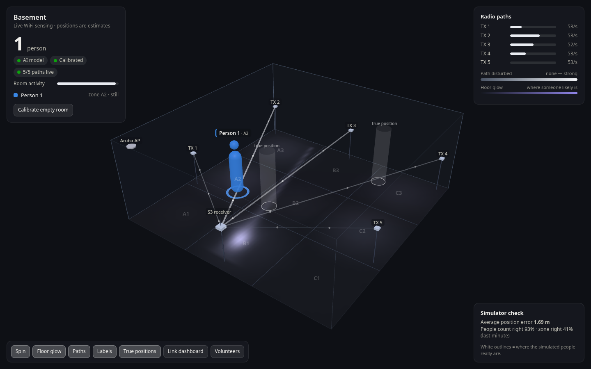
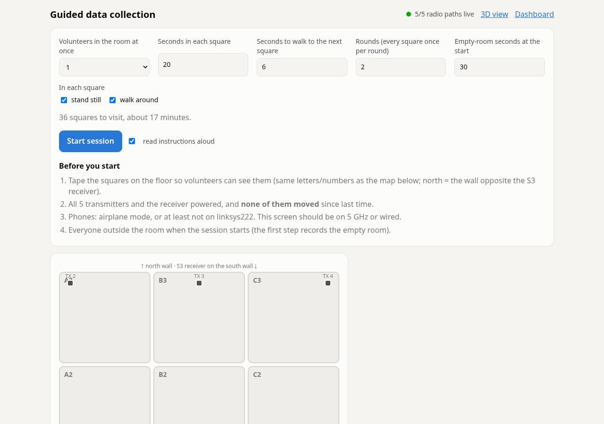

# WiFi CSI Room Sensing: seeing people with WiFi, no cameras

Cheap ESP32 boards send WiFi packets across a room. A person's body changes how those radio
waves travel, and the WiFi chip measures that as **Channel State Information (CSI)**. A
Raspberry Pi 5 collects the CSI, works out roughly where people are, and shows it as a
**slowly spinning 3D model of the room with the people in it**.



*The 3D view running on the built-in simulator. The white outlines are where the simulated
people really are, so you can see the estimate's error. Real-room accuracy has to be
measured with your own data; see [How accurate is it?](#how-accurate-is-it).*

---

## Contents

1. [Quick start](#quick-start)
2. [What this is (and isn't)](#what-this-is-and-isnt)
3. [How WiFi sensing works, in plain words](#how-wifi-sensing-works-in-plain-words)
4. [System overview](#system-overview)
5. [Hardware](#hardware)
6. [The room: zones, placement, room.json](#the-room-zones-placement-roomjson)
7. [Network design](#network-design)
8. [ESP32 firmware](#esp32-firmware)
9. [Raspberry Pi software](#raspberry-pi-software)
10. [The web pages](#the-web-pages)
11. [Signal processing, step by step](#signal-processing-step-by-step)
12. [Finding people: geometry, tracker, AI model](#finding-people-geometry-tracker-ai-model)
13. [Collecting training data with volunteers](#collecting-training-data-with-volunteers)
14. [Training the AI model](#training-the-ai-model)
15. [Deploying to the Pi](#deploying-to-the-pi)
16. [Access point setup](#access-point-setup)
17. [HTTP API reference](#http-api-reference)
18. [Data formats](#data-formats)
19. [The simulator](#the-simulator)
20. [How accurate is it?](#how-accurate-is-it)
21. [Configuration reference](#configuration-reference)
22. [Performance and resources](#performance-and-resources)
23. [Troubleshooting](#troubleshooting)
24. [Why not a pretrained "WiFi to 3D people" AI model?](#why-not-a-pretrained-wifi-to-3d-people-ai-model)
25. [Limitations and future work](#limitations-and-future-work)
26. [Repository layout](#repository-layout)
27. [Security notes](#security-notes)
28. [FAQ](#faq)
29. [Glossary](#glossary)
30. [Credits and licences](#credits-and-licences)

---

## Quick start

### Try it in 1 minute, no hardware needed

```bash
cd csi-arduino/pi_server
pip install -r requirements.txt       # flask, numpy, scikit-learn
./demo.sh                             # server + simulated basement, auto-calibrated
```

Open **http://localhost:5000/room**. The simulated room starts empty for 25 s, which is
used as the calibration. Then 1, 2 and 3 people walk in and out, in a loop. **Ctrl+C**
stops it. Demo data goes to `/tmp/csi-demo`.

### The real thing, in order

| # | Step | Where | Details |
|---|------|-------|---------|
| 1 | Put the linksys222 WiFi password into the receiver sketch | laptop | `./csi-arduino/deploy/fill_wifi_password.sh` |
| 2 | Flash the S3 receiver and ONE transmitter, check it works, then flash the other four | Arduino IDE | [ESP32 firmware](#esp32-firmware) |
| 3 | Prepare the Pi's SD card: user `csi`, SSH, linksys222 WiFi | laptop, card in a USB reader | `./csi-arduino/deploy/prepare_sd_card.sh` (see [Deploying](#deploying-to-the-pi)) |
| 4 | Deploy the Pi software | laptop, Pi on the ethernet cable | `./csi-arduino/deploy/deploy_to_pi.sh` |
| 5 | Pin the access point's channels | laptop, through the Pi | `./csi-arduino/deploy/ap_tunnel.sh`, then [AP setup](#access-point-setup) |
| 6 | Place the boards, measure them into `room.json` | basement | [The room](#the-room-zones-placement-roomjson) |
| 7 | Calibrate the empty room | `http://10.42.0.222:5000/room` | everyone out, press **Calibrate** |
| 8 | Record volunteers, train, reload | `/collect`, then `train_model.py` on the Pi | [Volunteers](#collecting-training-data-with-volunteers), [Training](#training-the-ai-model) |

---

## What this is (and isn't)

**It is:**

- A working pipeline: ESP32 transmitters → ESP32-S3 receiver → Raspberry Pi 5 → web
  dashboard with a 3D room view.
- Two ways of finding people:
  - a **geometric estimate** that works immediately;
  - an **AI model** (random forest) that you train on your own room with volunteers.
- A guided data-collection tool that tells volunteers where to stand, out loud, and
  labels the data by itself.
- A physics-style simulator so all of it can be developed and tested without hardware.

**It isn't:**

- **A camera.** It doesn't produce images, faces or skeletons. The 3D figures are symbols
  placed at the estimated positions.
- **Precise.** With one receiver and five transmitters, expect "which part of the room"
  (about a 2 m square), not centimetres. See
  [How accurate is it?](#how-accurate-is-it).
- **Plug-and-play across rooms.** Every room (and every furniture layout) needs its own
  calibration, and ideally its own training data.

---

## How WiFi sensing works, in plain words

1. **A WiFi packet isn't sent on one frequency, but on many at once.** At 20 MHz width,
   802.11n uses 52 data **subcarriers**, each 312.5 kHz apart, like 52 thin radio
   stations side by side.
2. **The receiver measures each subcarrier.** Before decoding a packet, the WiFi chip
   compares the known training symbols at the start of the packet (the *LTF*, Long
   Training Field) with what actually arrived. The result is one complex number per
   subcarrier: how much that frequency was weakened (amplitude) and delayed (phase). That
   list is the **CSI**.
3. **Radio takes many paths.** The signal arrives straight from the transmitter, and also
   bounced off walls, the floor, the ceiling, furniture and people. These copies add up
   differently on each subcarrier, so the CSI has a characteristic jagged "shape" (see the
   per-link charts on the [link dashboard](#the-web-pages)).
4. **A body changes the paths.**
   - Standing on or near the direct line between two boards, it **blocks** that line, so
     the signal strength (RSSI) drops by a few dB.
   - Standing anywhere, it **adds and removes reflections**, so the CSI shape changes.
   - Moving, it makes the CSI **wobble** from packet to packet.
5. **Each transmitter → receiver pair is a "link" or "path".** Five transmitters and one
   receiver make five links, each crossing a different part of the room. Comparing which
   links change, and how, against the empty room tells us roughly where people are.

The ESP32's CSI has limits. It has one antenna, so no direction finding. The phase isn't
stable between packets. The amplitude gets rescaled by automatic gain control (AGC). This
project uses **amplitude and RSSI only**, with AGC removed by normalisation.

---

## System overview

```
                          BASEMENT (about 20 x 20 ft)
   TX 2 (ESP32) ----------- TX 3 (ESP32) ------------ TX 4 (ESP32)
     |   \                     |                      /     |
     |     \                   |                    /       |
   TX 1      \  ESP-NOW broadcast, 50 packets/s each  /     TX 5
  (ESP32) ----\----- on linksys222's 2.4 GHz channel  /---- (ESP32)
                 \             |              /
                   \           |           /
                     [ ESP32-S3 receiver ]  measures CSI on every packet
                       192.168.1.60  |
                                     | UDP port 5005, batches of CSI samples
                                     v
   Aruba AP "linksys222" (192.168.1.10, no internet, no DHCP of its own)
                                     | 5 GHz
                                     v
   Raspberry Pi 5 (192.168.1.50 on linksys222, 10.42.0.222 on the laptop cable)
     server.py ......... receives UDP, logs CSV, serves the web pages (port 5000)
     analysis.py ....... 4x/s: scores links, finds people, publishes a snapshot
     localizer.py ...... room geometry, path-geometry estimate, tracker, AI model
     guided.py ......... volunteer schedule + automatic labels
     train_model.py .... learns zones from recorded volunteer sessions
                                     |
                                     v
   Browser (laptop / phone / TV on linksys222, or laptop on the cable)
     /room 3D view  .  /collect volunteer guide  .  / link dashboard
```

**The data path, timed:**

1. Each transmitter sends a tiny 12-byte ESP-NOW broadcast every 20 ms.
2. The S3's WiFi driver measures CSI on each one, within microseconds.
3. The S3 packs about 3 samples into one UDP packet, so each sample waits at most 50 ms.
4. The Pi stores each sample in a per-link ring buffer as it arrives.
5. Every 250 ms, the analysis thread looks at the last 1 s of every link and decides
   where people are.
6. The browser polls every 250 ms and animates smoothly between updates.

---

## Hardware

| Qty | Part | Role | Notes |
|---|---|---|---|
| 5 | ESP32 dev boards (WROOM-32) | **Transmitters**, `NODE_ID` 1–5 | Any of ESP32 / C3 / C6 / C5 run the same sketch |
| 1 | ESP32-S3 with an external dipole antenna | **Receiver** (`RECEIVER_ID 1`) | Mount the antenna vertically. Some S3 boards need a resistor or jumper moved to use the external connector |
| 1 | Raspberry Pi 5 | Collector, analysis, web server | Raspberry Pi OS (Bookworm or newer, with NetworkManager) |
| 1 | Aruba access point (Instant) | WiFi network "linksys222" | Powered by PoE, no uplink |
| – | Stands or shelves at about 1 m | Hold every board at the same height | Never move a board after recording training data |
| – | Masking tape | 3 × 3 floor grid for volunteers | Squares about 6 ft 8 in (2.03 m) |
| (opt.) | ESP32-C5 | Second receiver on 5 GHz | Code included (`csi_receiver_c5`), not used in the current setup |

**Board roles:**

- **Transmitters never join the WiFi.** They sit on the access point's channel and
  broadcast ESP-NOW packets from the fixed MAC address `1a:00:00:00:00:<NODE_ID>`.
- **The S3 joins linksys222** (so it can send UDP to the Pi) and listens in promiscuous
  mode at the same time. It measures CSI only on packets from MACs starting
  `1a:00:00:00:00`.

---

## The room: zones, placement, room.json

### Default layout

`csi-arduino/pi_server/room.json`:

```
              north wall
   TX 2 (0.25, 5.85)     TX 3 (3.05, 5.85)     TX 4 (5.85, 5.85)
        +-----------+-----------+-----------+
        |    A3     |    B3     |    C3     |
  TX 1  +-----------+-----------+-----------+
 (0.25, |    A2     |    B2     |    C2     |  TX 5 (5.85, 2.20)
  2.20) +-----------+-----------+-----------+
        |    A1     |    B1     |    C1     |
        +-----------+-----------+-----------+
   AP (0.30, 0.30)     S3 receiver (3.05, 0.25)
              south wall
```

- **Coordinates are metres** from the south-west floor corner: x points east, y north,
  z up. 20 ft = 6.10 m.
- **"South"** is simply the wall with the receiver; pick it and stay consistent.
- **Zones:** columns are letters (A = west), rows are numbers (1 = south). The grid size
  is set by `"zones": {"cols": 3, "rows": 3}`.

### Why this placement

- With **one receiver**, every link ends at the S3, so the links fan out from it like
  spokes.
- Putting the S3 in the middle of one wall, with transmitters spread over the other three
  walls and corners, makes the spokes cover the whole floor.
- Corners and wall-middles on the far side give the widest spread of angles.
- **All boards at the same height, about 1 m (chest height),** so the direct paths pass
  through people's torsos.

### Placement rules

1. **Measure where each board really is** (±10 cm) and edit `room.json`. Then restart:
   `sudo systemctl restart csi-server`.
2. **Never move, rotate or swap a board** once you've recorded training data. If you
   must, re-calibrate and record new training data.
3. **Label each board with its `NODE_ID`**, and make sure `room.json`'s `transmitters`
   keys match.
4. **Mount the S3's antenna vertically and fix the cable.** A moving antenna changes the
   CSI.
5. **Keep the doors the same** (open or closed) during calibration, recording and use.

### room.json fields

| Field | Meaning |
|---|---|
| `name` | Shown in the 3D view's title |
| `width`, `depth`, `height` | Room size in metres (x, y, z) |
| `zones.cols`, `zones.rows` | Floor grid used by `/collect` and the AI model |
| `receivers.<id>` | `x, y, z, label`. The id is the receiver's `RECEIVER_ID` |
| `transmitters.<id>` | `x, y, z, label`. The id is the transmitter's `NODE_ID` |
| `access_point` | Shown in 3D only; not used for sensing (the S3 doesn't measure AP packets) |
| `furniture` | Optional list of `{name, x, y, w, d, h}` boxes, drawn in 3D |

A link whose transmitter or receiver isn't in `room.json` still shows on the dashboards,
but can't be used for positions.

---

## Network design

### Addresses

| Device | Address | How it gets it |
|---|---|---|
| Aruba AP | 192.168.1.10 | Static (AP config) |
| Raspberry Pi 5 (WiFi) | **192.168.1.50/24** | Static, set by `setup_pi.sh` (NetworkManager profile `csi-linksys222`) |
| Raspberry Pi 5 (ethernet to laptop) | 10.42.0.222 | From the laptop's NetworkManager "shared" connection |
| ESP32-S3 receiver | **192.168.1.60** | Static, `csi_receiver_s3/config.h` |
| ESP32-C5 receiver (optional) | 192.168.1.100–199 | DHCP from the Pi |
| Phones and laptops on linksys222 | 192.168.1.100–199 | DHCP from the Pi (`csi-dhcp` service) |

### Why these choices

- **linksys222 has no router and no DHCP server.** Nothing is plugged into the AP except
  power. A laptop joining it associated fine but timed out waiting for an address. The
  original S3 sketch waited for an address before starting CSI, so it would wait forever.
  So:
  - the **S3 uses a fixed IP**, and works no matter what boots first;
  - the **Pi runs a small DHCP server** for everything else. It is bound to `wlan0` only,
    and gives out no gateway and no DNS.
  - `setup_pi.sh` first **probes for another DHCP server** and refuses to start its own if
    one answers. Two DHCP servers on one network would fight.
- **The Pi prefers 5 GHz** (`802-11-wireless.band a`). The S3 → AP leg is unavoidable on
  2.4 GHz, but the AP → Pi leg then travels on 5 GHz. That keeps the sensing channel
  quieter. It falls back to any band if 5 GHz fails.
- **The Pi's WiFi is never its internet route** (`ipv4.never-default yes`). While the
  ethernet cable is plugged in, the Pi reaches the internet through the laptop. That's how
  packages get installed.
- **WiFi power saving is off** on the Pi (`802-11-wireless.powersave 2`, plus
  `iw ... power_save off`) and on every ESP32. Power saving delays and drops packets.

### The laptop has one WiFi card

The development laptop's only WiFi card is on its home network (ORBI21), which is its
internet. **Joining linksys222 drops the internet** until you switch back:

```bash
nmcli connection up linksys222    # reach the Pi over WiFi (no internet meanwhile)
ssh csi-pi
nmcli connection up ORBI21        # back to the internet
```

- Never use the laptop profile `linksys222 1`. It's an IPv4 "shared" profile, which starts
  a second DHCP server on linksys222.
- A USB WiFi adapter would let the laptop be on both networks at once.
- While the Pi is on the cable, everything is reachable without leaving ORBI21:
  - the dashboard at `http://10.42.0.222:5000`;
  - the AP's admin page, through `ap_tunnel.sh`.

---

## ESP32 firmware

All the firmware is in `csi-arduino/`. It is an Arduino IDE project based on Espressif's
`esp-csi` examples.

### Arduino IDE setup (once)

1. **File → Preferences → Additional boards manager URLs:**
   `https://espressif.github.io/arduino-esp32/package_esp32_index.json`
2. **Boards Manager:** install "esp32 by Espressif Systems" **3.3.0 or newer**. The code
   was compile-tested on 3.3.12.

| Board | Tools → Board | USB CDC On Boot |
|---|---|---|
| ESP32 DevKit / WROOM-32 | ESP32 Dev Module | (n/a) |
| ESP32-C3 SuperMini | ESP32C3 Dev Module | **Enabled** |
| ESP32-C6 SuperMini | ESP32C6 Dev Module | **Enabled** |
| ESP32-S3 | ESP32S3 Dev Module | Enabled on the native USB port, Disabled on the UART port |
| ESP32-C5 | ESP32C5 Dev Module | Enabled on the native USB port, Disabled on the UART port |

The Serial Monitor runs at **115200 baud**. If an upload won't start, hold **BOOT** while
plugging in.

### Sketches

| Folder | Runs on | Does |
|---|---|---|
| `csi_transmitter/` | ESP32, C3, C6, C5 | Broadcasts ESP-NOW at 50 Hz, 802.11n MCS0, 20 MHz, fixed TX power, MAC `1a:00:00:00:00:<NODE_ID>` |
| `csi_receiver_s3/` | ESP32-S3 | Joins linksys222, captures CSI from the transmitters, sends UDP batches to the Pi |
| `csi_receiver_c5/` | ESP32-C5 | The same on 2.4 **or** 5 GHz. Also pings to get CSI from the AP itself (node 0) |

### What changed for this setup (vs. `csi-arduino.zip`)

- **S3 fixed IP** (`STATIC_IP`, `STATIC_GATEWAY`, `STATIC_SUBNET` in `config.h`).
  `WiFi.config()` is called before `WiFi.begin()`. With an empty `STATIC_IP` it uses DHCP
  again.
- **S3 refuses to start with the placeholder password.** It prints `WIFI_PASSWORD in
  config.h is still the placeholder` and stops, instead of failing to connect forever.
- **Transmitters find the channel by themselves.** At power-up, `findAccessPointChannel()`:
  - scans for `AUTO_CHANNEL_SSID` (default `"linksys222"`);
  - keeps only results on its own band, ignoring linksys222's 5 GHz radio;
  - takes the strongest one;
  - retries for `AUTO_CHANNEL_TIMEOUT_MS` (30 s) in case the AP is still booting;
  - falls back to `WIFI_CHANNEL` (11).

  The ESP-NOW peer uses the runtime channel. **After changing the AP's channel, just
  power-cycle the transmitters.**
- **Pi address:** `PI_SERVER_IP` = `192.168.1.50`. On the C5, `PING_TARGET_IP` =
  `192.168.1.50`, because there's no router to ping.

### Settings, by file

**`csi_receiver_s3/config.h`**

| Setting | Value | Meaning |
|---|---|---|
| `WIFI_SSID` / `WIFI_PASSWORD` | `linksys222` / placeholder | Fill with `deploy/fill_wifi_password.sh` |
| `PI_SERVER_IP` / `PI_SERVER_PORT` | `192.168.1.50` / `5005` | Where the CSI goes |
| `STATIC_IP` | `192.168.1.60` | `""` = DHCP |
| `RECEIVER_ID` | `1` | Must match `room.json` → `receivers` |
| `NODE_MAC_PREFIX` | `1a:00:00:00:00` | Which senders count as transmitters |
| `MAX_UDP_PAYLOAD`, `BATCH_FLUSH_MS`, `CSI_QUEUE_LENGTH` | 1400, 50, 64 | Batching |

**`csi_transmitter/config.h`**

| Setting | Value | Meaning |
|---|---|---|
| `NODE_ID` | **1 to 5, different on each board** | Becomes the last MAC byte and the dashboard's "TX n" |
| `USE_5GHZ` | 0 | 1 only on a C5 |
| `AUTO_CHANNEL_SSID` | `"linksys222"` | `""` = always use `WIFI_CHANNEL` |
| `WIFI_CHANNEL` | 11 | Fallback channel |
| `SEND_RATE_HZ` | 50 | **Same on every board** |
| `TX_POWER_DBM` | 15 | **Same on every board** |

### Bring-up order (do not skip)

1. Run `./csi-arduino/deploy/fill_wifi_password.sh` on the laptop. It reuses the laptop's
   saved linksys222 password, or asks you to type it. `--clear` restores the placeholder.
2. **Flash the S3** (`csi_receiver_s3`). In its Serial Monitor, check for:
   ```
   [WIFI] Using fixed IP 192.168.1.60
   [WIFI] Connected. S3 IP: 192.168.1.60
     ACCESS POINT CHANNEL: 11
   [CSI] Capturing CSI from transmitters 1a:00:00:00:00:xx
   ```
3. **Flash ONE transmitter** with `NODE_ID 1`. Its Serial Monitor shows
   `[RADIO] Found "linksys222" on channel 11 (-48 dBm)`, then every 5 s
   `node 1 | pkt/s 50.0 | ...`.
4. In the S3's Serial Monitor, check for `node   1 | CSI/s  49.8 | heard/s  49.8 | RSSI ...`.
5. Only now flash the other four (`NODE_ID` 2, 3, 4, 5). Label each one.

The firmware changes have been **compile-checked**, not yet run on a board. That's why
this order matters. If something regresses, the original code is in `csi-arduino.zip` in
git history.

---

## Raspberry Pi software

Everything is in `csi-arduino/pi_server/`. It is pure Python plus static web files.

| File | What it does |
|---|---|
| `server.py` | Entry point. UDP listener (thread), CSV logger, Flask web server: all pages and APIs. Extends the original zip's server; the original dashboard and APIs still work |
| `analysis.py` | The live engine (thread, 4 updates/s): calibration jobs, per-link scoring, localisation, tracking, AI inference, simulator scoring, the `/api/state` snapshot |
| `localizer.py` | `Room` (geometry, zones), `GeometricLocalizer`, `fade_weights`, `Tracker`, `ZoneModel` (loads the trained model) |
| `csi_features.py` | CSI bytes → amplitudes → normalised → window features. **Shared by live and training**, so both compute identical numbers. Includes the layout self-check |
| `guided.py` | `GuidedSession`: the volunteer schedule, current step, CSV labels; `parse_label()` |
| `train_model.py` | Offline: reads guided-session CSVs, builds windows, trains and evaluates, saves `models/zone_model.joblib` + `.json` |
| `sim_room.py` | Simulated basement that sends real-format UDP (see [The simulator](#the-simulator)) |
| `demo.sh` | Server + simulator + auto-calibration, for trying everything without hardware |
| `fake_receiver.py`, `compare_bands.py` | From the original zip: a simple fake receiver, and a 2.4 vs 5 GHz comparison of recordings |
| `room.json` | Room size and board positions |
| `static/room.html`, `static/room.js` | The 3D view |
| `static/collect.html` | The volunteer guide |
| `static/vendor/three/` | three.js 0.186.1 (MIT), bundled because linksys222 has no internet |

**Threads:**

- the **UDP listener** parses batches, updates per-link stats and ring buffers, and
  writes the CSV;
- the **analysis loop** runs every 250 ms;
- **Flask** serves the requests.

They share the `links` dict under `links_lock`. Each link keeps the last **60 s** of
normalised amplitudes (`LinkBuffer`, 3000 samples).

**Services on the Pi** (installed by `setup_pi.sh`):

| Service | Runs | Logs |
|---|---|---|
| `csi-server` | `python3 -u server.py` as your user, restarts on crash, starts at boot | `journalctl -u csi-server -f` |
| `csi-dhcp` | `dnsmasq` on `wlan0` only, no DNS (`port=0`) | `journalctl -u csi-dhcp` |

**Python dependencies:** Flask ≥ 2.2, numpy ≥ 1.24, scikit-learn ≥ 1.2 (it brings
joblib). On the Pi they are installed from apt (`python3-flask python3-numpy
python3-sklearn`). The code was tested on Python 3.11 with numpy 1.24, sklearn 1.2 and
Flask 2.2 (Debian Bookworm's versions, in Docker), and on Python 3.14 with current
releases.

---

## The web pages

All served by the Pi on port 5000: `http://192.168.1.50:5000` on linksys222, or
`http://10.42.0.222:5000` over the cable.

### `/room`: the 3D view


| Element | Meaning |
|---|---|
| Slow spin | About 2 minutes per turn. Drag to look around; spinning resumes 8 s after you let go. The walls nearest the camera fade, doll-house style |
| Boards | Small boxes on poles at their `room.json` positions. The S3 is the larger box with an antenna |
| Radio paths | One line per link. **Brighter and thicker = more disturbed** (a body near that path). Dots travel along live paths; offline paths go dim |
| Floor glow (violet) | Where someone probably is: the geometric likelihood, blended with the AI model's zone probabilities in model mode |
| People | A figure per detected person, in categorical colours (Person 1 blue, 2 orange, 3 green), with a pulsing floor ring and a label (zone, moving/still). A moving person bobs |
| Top-left panel | Head count; mode chip (**Path geometry** or **AI model**); calibration chip; "n/5 paths live"; room activity bar; list of people |
| Top-right panel | Per-path disturbance bars and packet rates, legend, AI model status |
| Bottom bar | Toggles: Spin, Floor glow, Paths, Labels, True positions (simulator only); links to the other pages |
| Banner | Shows the one thing to fix first: no data, CSI in an unexpected format, not calibrated, busy calibration, or calibrating |
| Simulator check | Only with `sim_room.py`: true positions as white outlines, plus the last minute's average error and count accuracy |

### `/collect`: the volunteer guide


- **Setup form** (shown when no session is running): volunteers at once (1–3), seconds
  per square, seconds to walk, rounds, empty-room seconds, stand and/or walk, and "read
  instructions aloud". It shows the number of steps and the duration.
- **During a session**:
  - a huge instruction ("Walk to your square", "Stand still in your square", "Everyone OUT
    of the room") with a countdown;
  - a floor map with each volunteer's colour badge in their square, and a dashed preview
    of the next one;
  - progress and a stop button.
- **Speech synthesis** reads the instructions ("Blue, go to B 2"). Beeps mark phase
  changes, and 3-2-1 ticks count down to the end of each walk.
- **Data watch:** a status dot and a warning if fewer than 5 paths are live. Recording
  with a dead transmitter wastes the session.



### `/`: the link dashboard (from the original zip, extended)


- **Per-link cards:** samples/s, RSSI, lost samples, motion score, and the live CSI
  amplitude across all subcarriers.
- **Band comparison:** 2.4 GHz vs 5 GHz.
- **Recording label:** type a label (e.g. `sitting`) to record free-form labelled data.
- **New on this page:** a calibrate button, calibration status, and links to `/room` and
  `/collect`.

---

## Signal processing, step by step

All of this lives in `csi_features.py` and `analysis.py`.

### 1. Getting amplitudes from the bytes

- The S3 is configured like Espressif's `csi_recv` (`lltf_en`, `htltf_en`,
  `stbc_htltf2_en`, `ltf_merge_en`, `channel_filter_en`), so `csi_len` can be 128, 256 or
  384 bytes.
- Every packet type has the **LLTF block, the first 128 bytes**, so only that block is
  used. Features then don't change when a packet arrives as 802.11g instead of 802.11n.
- The bytes are signed int8 pairs `[imag, real]` per subcarrier, in driver order
  `0..31, -32..-1`.
- The **52 data subcarriers** −26..−1 and +1..+26 are at block positions 38..63 and
  1..26. DC (0) and the guards (27..37) are dropped.
- Amplitude = √(real² + imag²).
- When the sample's `first_word_invalid` flag is set, subcarrier +1 is unreliable, so it
  copies +2.

### 2. Layout self-check

- Real 802.11 CSI has **nothing in the guard subcarriers**. For the first 200 samples of
  every link, the server computes:
  `mean amplitude at block positions 29..35 / mean amplitude of the data subcarriers`.
- If the median is above **0.25**, the bytes aren't in the order assumed above (different
  chip, firmware or CSI settings). The server then:
  - logs `[CSI] !!! ... CSI layout doesn't match`;
  - shows a banner on `/room`.

  This turns a silent mis-parse into a visible error on day one.

### 3. Removing automatic gain control

- The ESP32's AGC rescales the whole CSI vector in steps. Every sample is therefore
  **divided by its own mean amplitude**. Without this, a gain step looks like someone
  walking in.
- Absolute signal strength is kept separately as **RSSI**, which the radio measures
  before AGC.

### 4. Window statistics (1 s per link, every 250 ms)

- `a` holds the normalised amplitude vectors in the window.
- *m* = mean over time per subcarrier, *s* = standard deviation over time per subcarrier.

| Quantity | Formula | Means |
|---|---|---|
| motion | 100 · mean(*s*) / mean(*m*) | Overall wobble, relative to the overall level. Robust to subcarriers sitting in a deep fade |
| deviation | 100 · ‖*m* − *b*‖ / ‖*b*‖, *b* = empty-room mean | Shape change vs. the empty room. Catches people **standing still** |
| ΔRSSI | mean RSSI − empty-room RSSI (dB) | Power change; the **local** cue |
| RSSI std | std of RSSI in the window (dB) | Power wobble; local-ish movement cue |

### 5. Calibration (empty-room baseline)

You record ~20 s of the empty room, with the button on `/room` or `/`, or automatically
during the first step of every guided session. Per link, `build_baseline()` stores:

- **`mean` / `std`:** the empty-room mean and std per subcarrier.
- **Window-to-window noise** of deviation, motion, RSSI mean and RSSI std, as robust
  statistics (median and 1.4826 × MAD), with floors so a perfectly quiet link doesn't
  give infinite z-scores:

  | Statistic | Floor |
  |---|---|
  | σ(dev) | max(0.4, 0.15 μ) |
  | σ(motion) | max(0.3, 0.15 μ) |
  | σ(RSSI std) | max(0.15, 0.2 μ) |
  | RSSI jitter | 0.25 dB |

- **Busy check:** if motion σ > 0.5 μ or dev σ > 2.5 on any link, the calibration is
  flagged as "looked busy". Someone was probably still in the room.

It is saved to `data/calibration.json`, reloaded at start-up, and invalidated if
`FEATURE_VERSION` changes.

### 6. From numbers to 0..1 "disturbance" scores

The generic mapping, with *z* = (value − μ)/σ:

```
disturbance(value; mu, sigma, z0, scale) = 1 - exp( -max(0, z - z0) / scale )
```

| Score | Built from | Used for |
|---|---|---|
| `presence` = max(dist(dev; z0=3, scale=10), dist(motion; z0=3, scale=10)) | Shape + wobble. **Not local:** in a small room, a person anywhere changes every link's reflections | Room activity bar; "moving" flag |
| `rssi_change` = 1 − exp(−max(0, \|ΔRSSI\| − 1 dB − 2·jitter) / 3 dB) | Power change, either direction (a link in a fade can get *stronger* when blocked) | Localisation |
| RSSI wobble = dist(RSSI std; z0=2.5, scale=5) | Power wobble | Localisation |
| **`disturbance`** = max(rssi_change, RSSI wobble) × fade weight | Local cue per link | The geometric estimate and the path brightness in 3D |

**Before calibration**, each link is compared with its own quietest moments (the 10th
percentile of the last ~60 s). Only movement can be detected that way.

### 7. Fade weighting

- A link "in a deep fade" is much weaker than its length predicts, because reflections
  cancel the direct signal. Such a link jumps around whenever *anyone* moves *anywhere*.
- The fit runs over the calibration RSSIs:
  - P₀ = median(RSSIᵢ + 20·log₁₀ dᵢ);
  - fadeᵢ = RSSIᵢ − (P₀ − 20·log₁₀ dᵢ);
  - weight = clip(1 + min(0, fade)/12, 0.25, 1).
- So a link 9 dB or more below the model counts at a quarter.
- The `/api/state` link field `reliability` shows each weight.

---

## Finding people: geometry, tracker, AI model

### Geometric estimate (`GeometricLocalizer`, works without training)

1. **Grid:** the floor is cut into 10 cm cells, excluding 30 cm along the walls.
2. **Influence maps:** each link *i* is a straight segment, transmitter → receiver. For
   every cell *x*, the expected disturbance if one person stood there is
   `e_i(x) = exp(-(distance from x to segment i / 0.55 m)^2)`.
3. **Pattern matching:** compare the measured disturbance vector *s* with each cell's
   expected pattern by cosine similarity, `c(x) = s·e(x) / (|s| |e(x)|)`. The likelihood
   is `exp(14·(c − 1)) × wall prior`. The likelihood map (normalised, faded when signals
   are weak) **is the floor glow**.
4. **One person:**
   - The strongest cell is a candidate if its fitted amount `A = s·e / e·e` ≥ **0.22**.
   - The person is placed at the **likelihood-weighted centroid** of cells within 2.5 m
     scoring ≥ 60% of the peak. When only one path is disturbed, every point along it
     fits equally, and the middle is the honest guess.
5. **More people:** the first person's share (A·e) is subtracted and the search repeats.
   A 2nd or 3rd person needs A ≥ **0.70** and must be ≥ **2 m** from people already
   found. That is strict on purpose: with one receiver, leftovers easily become ghosts.

### Tracker (`Tracker`)

- **Gating:** detections continue existing people within **1.6 m**. Positions follow with
  smoothing (30% per update, about a 1 s time constant).
- **Jumps:** when exactly one person is shown and one detection jumps further than the
  gate, it's treated as the same person gliding, not a new one.
- **Confirmation:** a new person is shown after **2** consecutive updates. A 2nd or 3rd
  person needs **5** (1.25 s).
- **Removal:** a person disappears after **8** missed updates (2 s).
- **Numbering:** numbers are given only on confirmation, as the lowest free number. One
  person in the room is always "Person 1".

### AI model (`ZoneModel`, after training)

**Features.** For every link, 30 numbers per 1 s window, all relative to the empty room:

| Features | Count |
|---|---|
| Shape change per group of 4 adjacent subcarriers: 100 × (m − b)/b, grouped | 13 |
| Wobble per group: 100 × s/b, grouped | 13 |
| deviation, motion, ΔRSSI, RSSI std | 4 |

With five links that's 150, plus five "link present" flags, for **155 features**. A
missing link gives zeros and present = 0, so the model degrades instead of crashing.

**Two random forests** (scikit-learn, 300 trees each, `min_samples_leaf=2`,
`class_weight="balanced"`):

1. a **zone model**, multi-output: for each square A1..C3, the probability someone is
   there;
2. a **head-count model**: P(0), P(1), P(2), P(3) people.

**Decision:**

- The head-count probabilities are smoothed (60/40 exponential average).
- *N* = the most likely count.
- The people are the **N most likely squares**, with a little stickiness (+0.08) for
  squares already shown, so they don't flicker.
- Each person's exact point inside their square comes from the geometric likelihood map
  (its peak within that square), or the square's centre if the map is flat there.

Why a count model: thresholding every square at 0.5 independently got the number of
people right only 28% of the time on the simulator. "Count, then the top-N squares" got
82%.

---

## Collecting training data with volunteers

**The complete briefing, floor-tape plan and session plan are in
[`csi-arduino/VOLUNTEERS.md`](csi-arduino/VOLUNTEERS.md).**

### What to tell the volunteers

> Don't touch or move the boards. Phone in airplane mode, no backpacks. You're Blue,
> Orange or Green: the screen and voice say which taped square to go to. "Stand still" is
> arms relaxed, no talking. "Walk around inside your square" is slowly, inside the tape.
> "Everyone out" means leave the room completely, not standing in the doorway, until
> called back.

### How a guided session works (`guided.py`)

1. **Empty room** (default 30 s): everyone outside. This step **re-calibrates
   automatically**.
2. **For each round × each activity** (stand / walk), every volunteer visits every
   square once, in random order. With *V* volunteers, volunteer *j* is offset ⌊9/V⌋
   squares along the shuffled list, so nobody shares a square and everyone covers all
   nine.
3. **Each step is a walk phase (default 6 s) then a hold phase (default 20 s).**
4. **Empty room again** at the end (half length), to check for drift.

Every CSI row logged during a session carries a label like:

```
guided;sess=s20261105-1400;step=4;phase=hold;act=stand;occ=A2+C1;n=2
```

| Part | Meaning |
|---|---|
| `phase` | `move` (walking, **not** used for training) or `hold` (in position) |
| `act` | `empty`, `stand`, or `walk` (moving around inside your own square) |
| `occ` | Occupied squares, `+`-separated, or `none` |
| `n` | How many people |

Each session's schedule is also saved to `data/sessions/<id>.json`.

### Suggested plan (about 1.5 hours)

| # | In the room | Rounds | Activity | About |
|---|---|---|---|---|
| 1 | 1 volunteer (A) | 2 | stand + walk | 17 min |
| 2 | 1 volunteer (B, a different build) | 2 | stand + walk | 17 min |
| 3 | 2 (A + B) | 2 | stand | 9 min |
| 4 | 3 (A + B + C) | 2 | stand | 9 min |
| 5 | 1 (C), the **held-out test** | 1 | stand + walk | 9 min |

---

## Training the AI model

Run it **on the Pi**. A saved model only loads with the scikit-learn version that trained
it, and the server checks this.

```bash
ssh csi-pi
cd ~/csi/pi_server
python3 train_model.py --list                     # sessions found in data/
python3 train_model.py --test-session <id>        # train on the others, test on this one
python3 train_model.py                            # final model from all sessions
curl -X POST localhost:5000/api/model/reload      # /room switches to "AI model"
```

**What it does:**

1. Reads all `data/csi_*.csv` files and keeps rows with guided labels. Its own options
   are `--sessions`, `--data-dir`, `--room` and `--out`.
2. Builds each session's empty-room baseline from **its own first empty step**, the same
   way live calibration does. If there isn't one, it falls back to `data/calibration.json`.
3. Cuts each hold step into **1 s windows every 0.5 s**, skipping the first 1.5 s
   (settling). It skips windows where fewer than 60% of the links have data.
4. **Honest self-test:** 5-fold `GroupKFold` with **whole steps held out**. Windows from
   the same visit never land in both training and testing, because neighbouring seconds
   look almost identical and would make the score meaninglessly high.
5. Prints:
   - single person, exact zone;
   - single person, zone or neighbour;
   - empty room recognised;
   - number of people right, overall and by count;
   - every zone right;
   - a confusion table.
6. Fits the final models on everything. It saves `models/zone_model.joblib` (both
   forests) and `models/zone_model.json` (zones, link order, feature version, sklearn
   version, metrics, sessions, date).

**Warnings it gives:**

- squares visited fewer than 2 times: record more rounds;
- no usable windows: check the transmitters were running;
- too few steps to self-test.

**When to retrain:**

- a board moved;
- the AP channel changed;
- big furniture changes;
- `FEATURE_VERSION` changed in `csi_features.py`. The server then says "re-run
  train_model.py".

---

## Deploying to the Pi

### Step 0: prepare the SD card (`deploy/prepare_sd_card.sh`, on the laptop)

Raspberry Pi OS "trixie" is configured at first boot by **cloud-init**, from the files
`user-data`, `meta-data` and `network-config` on the card's FAT boot partition. Writing
those files needs no root, so with the card in a USB reader:

```bash
lsblk                                          # find the card: partitions "bootfs" + "rootfs"
udisksctl mount -b /dev/sdX1                   # its bootfs partition
CSI_WIFI_PSK='<linksys222 password>' ./csi-arduino/deploy/prepare_sd_card.sh /run/media/$USER/bootfs
udisksctl unmount -b /dev/sdX1 && udisksctl power-off -b /dev/sdX
```

On its next boot, the Pi gets:

- user **`csi`**: your SSH key only, passwordless sudo. Set a console password later with
  `sudo passwd csi`.
- **SSH on**.
- the WiFi country set, and the radio unblocked.
- **linksys222 at 192.168.1.50**, never the default route.

Details:

- The script writes a **new cloud-init instance id**. Without that, cloud-init treats the
  card as "already set up" and ignores the files.
- The image's original files are kept as `*.orig`.
- The WiFi password is **wiped from the boot partition** after first use.

Boot the Pi with the ethernet cable to the laptop still plugged in, so it has internet for
the next step.

### First time (`deploy/deploy_to_pi.sh`, run on the laptop with the Pi on the cable)

1. Checks SSH is open on `10.42.0.222`. If not, it tells you how to enable it.
2. Installs your key `~/.ssh/id_ed25519.pub` with `ssh-copy-id`. This asks the Pi's
   password once.
3. Copies `pi_server/` and `deploy/` to `~/csi` on the Pi. It never overwrites the Pi's
   `data/` or trained models.
4. Sends the linksys222 password over SSH into a mode-600 file, which `setup_pi.sh`
   shreds after use.
5. Runs `sudo bash ~/csi/deploy/setup_pi.sh` on the Pi.
6. Adds `Host csi-pi` (192.168.1.50) and `Host csi-pi-eth` (10.42.0.222) to
   `~/.ssh/config`.

### What `setup_pi.sh` does (safe to re-run)

| Step | Action |
|---|---|
| 1 | `apt install python3-flask python3-numpy python3-sklearn python3-joblib nmap dnsmasq-base iw rfkill`. It needs internet, which the laptop's cable provides |
| 2 | Sets the WiFi country (`US`, override with `COUNTRY=`) so the radio may turn on, and lists existing WiFi profiles, leaving them untouched |
| 3 | Creates the NetworkManager profile `csi-linksys222`: static 192.168.1.50/24, never-default, IPv6 off, power-save off, prefer 5 GHz, autoconnect priority 50. Then brings it up |
| 4 | Probes for another DHCP server on linksys222 (`nmap --script broadcast-dhcp-discover`). If one answers, it does **not** start the Pi's |
| 5 | Writes `/etc/csi/dnsmasq-linksys222.conf` and enables `csi-dhcp`: pool .100–.199, `wlan0` only, no router, no DNS |
| 6 | Installs and starts the `csi-server` systemd service; enables `ssh` |
| 7 | Opens ufw ports if ufw is active; prints the addresses, URLs and AP reachability |

Overrides: `SSID`, `PI_IP`, `PREFIX`, `DHCP_START`, `DHCP_END`, `WIFI_BAND` (`a` / `bg`
/ `""`), `COUNTRY`, `WIFI_IF`.

### Later

```bash
./csi-arduino/deploy/deploy_to_pi.sh --code    # copy new code, restart csi-server
ssh csi-pi 'journalctl -u csi-server -f'       # live logs
ssh csi-pi 'sudo systemctl restart csi-server' # e.g. after editing room.json
```

---

## Access point setup

Full guide: [`csi-arduino/deploy/AP_SETUP.md`](csi-arduino/deploy/AP_SETUP.md).

**Plan:** 2.4 GHz fixed on channel **11** at 20 MHz, and 5 GHz fixed on **157**.

**Reaching the admin page without leaving the home network:**

1. Run `./csi-arduino/deploy/ap_tunnel.sh`. It tunnels laptop → Pi → AP.
2. Open `https://localhost:4343`.

**Settings that matter for sensing:**

- **Administrator-assigned channel** on both radios (never automatic). Automatic channel
  changes break sensing until the transmitters are power-cycled.
- **2.4 GHz kept at 20 MHz** ("Wide channel bands" not including 2.4 GHz).
- **Off-channel scanning off.** Scanning makes the AP hop away briefly, leaving gaps in
  the CSI.
- **Deny inter-user bridging off,** broadcast filtering not `All`, and Enforce DHCP off.
  The S3 → Pi traffic is client-to-client.

After any channel change: power-cycle the transmitters, calibrate again, and retrain.

---

## HTTP API reference

The base URL is `http://<pi>:5000`. Everything is JSON.

| Method | Path | Body | Returns |
|---|---|---|---|
| GET | `/api/state` | – | Everything the 3D view shows (below) |
| GET | `/api/room` | – | `room.json` + `zone_names` |
| POST | `/api/calibrate` | `{"seconds": 20}` (8–55) | `{"ok": true}`. Starts recording the empty room |
| POST | `/api/collect/start` | `{"volunteers":1-3, "hold_s":20, "move_s":6, "rounds":2, "activities":["stand","walk"], "empty_s":30}` | Session id + state |
| POST | `/api/collect/stop` | – | Stops the session; data so far is kept |
| GET | `/api/collect` | – | Session state: running, step (phase, act, zones, remaining), next, progress, ends_in |
| POST | `/api/model/reload` | – | Re-reads `room.json` and the model: `{"ok", "status"}` |
| POST | `/api/sim/truth` | `{"people":[{"id","x","y"}]}` | Used only by `sim_room.py` |
| GET | `/api/links` | – | The original per-link summaries (rate, RSSI, lost, motion, latest amplitudes), band comparison |
| GET/POST | `/api/label` | `{"label": "..."}` | The free-form recording label |

### `/api/state` fields

| Field | Meaning |
|---|---|
| `mode` | `"geometry"` or `"model"` |
| `model_status` | Human-readable model state ("loaded (...)", "no model yet ...", version mismatch ...) |
| `calibration` | `{state: none/running/ok/failed, message, progress, created, busy_links}` |
| `links[]` | Per link: `key` (e.g. `r1-t3-24`), `receiver_id`, `tx_node_id`, `band`, `online`, `rate`, `rssi`, `lost`, `calibrated`, `has_position`, `motion`, `deviation`, `drssi`, `disturbance` (0..1, local), `presence` (0..1), `moving`, `reliability` (fade weight), `layout_ok` |
| `links_online` | Number of live links |
| `layout_warning` | Link keys whose CSI failed the layout self-check |
| `activity` | max `presence` over the links (0..1) |
| `people[]` | `{id, x, y, zone, confidence, moving}`, in metres in room coordinates |
| `zone_probs` | `{A1: p, ...}` in model mode, else null |
| `heat` | `{nx, ny, data}`: base64 uint8 grid, row-major, starting at the south-west corner (row = y) |
| `sim` | Only with the simulator: `{truth[], error_m, count_accuracy, zone_accuracy}` |
| `collect` | The same as `/api/collect` |
| `csv_rows` | Rows written to the current CSV |

---

## Data formats

### UDP packet (S3 → Pi, port 5005), little-endian

One packet = one batch header, then *n* × (sample header + CSI bytes). Defined in
`csi_packet.h`; it must match `server.py`.

**Batch header (12 bytes):**

| Field | Type | Meaning |
|---|---|---|
| `magic` | u16 | `0xC51A` |
| `version` | u8 | 2 |
| `receiver_id` | u8 | `RECEIVER_ID` |
| `batch_seq` | u32 | +1 per UDP packet |
| `sample_count` | u8 | Samples that follow |
| `reserved` | 3 × u8 | 0 |

**Sample header (16 bytes):**

| Field | Type | Meaning |
|---|---|---|
| `tx_node_id` | u8 | Transmitter (0 = access point) |
| `rssi` | i8 | dBm |
| `noise_floor` | i8 | dBm |
| `channel` | u8 | 1–13 = 2.4 GHz, 36+ = 5 GHz |
| `rx_format` | u8 | 0 = 11b/g, 1 = 11n ... |
| `first_word_invalid` | u8 | 1 = first 4 CSI bytes unreliable |
| `csi_len` | u16 | CSI bytes that follow (≤ 612) |
| `tx_seq` | u32 | Transmitter's packet counter (gaps = lost packets) |
| `rx_timestamp_us` | u32 | Receiver radio clock |

### ESP-NOW payload (transmitter → air, 12 bytes)

`magic 0xC5A1 (u16), version 1 (u8), node_id (u8), seq (u32), tx_time_us (u32)`.

The S3 measures CSI on the radio signal itself; the payload only provides the counter.

### CSV (`data/csi_YYYYMMDD_HHMMSS.csv`)

One row per CSI sample:

`pi_time, label, receiver_id, tx_node_id, band, receiver_ip, batch_seq, tx_seq,
rx_timestamp_us, rssi, noise_floor, channel, rx_format, first_word_invalid, csi_len, csi`

`csi` is the space-separated signed values `imag real imag real ...`.

**By default only labelled data is written** (`CSV_ONLY_LABELED = True`): rows are kept
while a guided session runs or a manual label is set. Writing stops below 2 GB free disk.
Logging everything would be roughly a gigabyte or more per hour.

### Other files

| File | Content |
|---|---|
| `data/calibration.json` | `{feature_version, created, source, links: {key: baseline}}` |
| `data/sessions/<id>.json` | Session config + every step with start/end times |
| `models/zone_model.joblib` | `{"zones": RandomForest, "count": RandomForest}` |
| `models/zone_model.json` | Zones, link order, feature version, sklearn version, metrics, sessions, date |

---

## The simulator

`sim_room.py` pretends to be the S3. It reads `room.json` and sends UDP in the exact real
format.

**What it models:**

- **Paths:** direct; reflections off the 4 walls, the floor and the ceiling (image
  method); and 9 fixed "furniture" scatterers, placed by `--seed`. That gives a
  position-dependent fingerprint.
- **Per subcarrier:** the complex sum of all paths at its own frequency, for channel 11
  plus *k* × 312.5 kHz.
- **People:**
  - each person **reflects** (a scatter path through their torso);
  - and **blocks** every path segment passing within ~0.22 m (up to 80% amplitude);
  - breathing and swaying when still, continuous motion when walking.
- **ESP32 quirks:**
  - AGC in 1 dB steps;
  - a random common phase per packet;
  - integer RSSI;
  - 384-byte CSI (LLTF + HT-LTF + STBC block);
  - 2% 128-byte 802.11g samples;
  - 5% `first_word_invalid`;
  - 1% lost packets.

**Modes:**

```bash
python3 sim_room.py                         # script: 0,1,2,3,1,2,0 people, repeating (~4.5 min)
python3 sim_room.py --people 2              # always 2 wandering
python3 sim_room.py --script "0:20,1:60"    # your own script (people:seconds,...)
python3 sim_room.py --follow-collect        # acts out the guided session on /collect
python3 sim_room.py --host 192.168.1.50     # send to a Pi from a laptop
```

It posts its true positions to `/api/sim/truth`. The 3D view then draws them and scores
itself; `--no-truth` turns that off.

The simulator tests the **software**. It doesn't predict real-room accuracy: real bodies,
walls and ESP32 noise differ.

---

## How accurate is it?

### Measured on the simulator (not the real basement)

| | Path geometry (no training) | AI model |
|---|---|---|
| Empty room recognised | yes | 100% |
| 1 person: position error | ~1.4–1.7 m | ~1.0–1.5 m (median ~1.0–1.3 m) |
| 1 person: head count right | ~75% | ~80–90% |
| 2 people | usually shown as 1 | usually shown as 1 |
| Self-test, standing in squares (held-out steps) | – | exact square 54%, square or neighbour 84%, count 82% |

The AI model was trained on two simulated guided sessions (1 volunteer × 2 rounds, and 2
volunteers × 2 rounds), then tested on people wandering freely. For scale, always
guessing the room's centre would be off by ~2.3 m on average.

### On real hardware

Unknown until you measure it. Record the sessions in
[the plan](#suggested-plan-about-15-hours), then run
`train_model.py --test-session <the held-out one>`. These help:

- **more sessions on different days** (generalisation);
- **different volunteers** (body size);
- **boards never moved**;
- **a fresh empty-room calibration before each use**;
- quiet 2.4 GHz air: phones in airplane mode, and nothing streaming on channel 11.

### What is verified

| Check | Status |
|---|---|
| Firmware compiles: S3 receiver, transmitter (ESP32 and C3), C5 receiver, on ESP32 core 3.3.12 | done |
| Firmware runs on boards | **not yet** |
| Server + simulator + calibration + guided session + training + model reload, end to end | done |
| The same on Python 3.11 / numpy 1.24 / sklearn 1.2 / Flask 2.2 (Debian Bookworm, in Docker) | done |
| Web pages render with no JS errors (headless Chromium, desktop and phone width) | done |
| `deploy_to_pi.sh` / `setup_pi.sh` on the real Pi | **not yet** (Pi SSH was off) |

---

## Configuration reference

### `localizer.py`

| Constant | Default | Effect |
|---|---|---|
| `CELL_M` | 0.10 | Heat-map cell size (m) |
| `PATH_WIDTH_M` | 0.55 | How far from a path a person still disturbs it |
| `SHARPNESS` | 14 | Higher = tighter glow blobs |
| `WALL_MARGIN_M` | 0.30 | No people inside the walls |
| `MIN_STRENGTH` | 0.22 | Weakest disturbance counted as a person |
| `EXTRA_PERSON_STRENGTH` | 0.70 | Needed for a 2nd/3rd person (geometry mode) |
| `EXTRA_PERSON_GAP_M` | 2.0 | Minimum distance between people (geometry mode) |
| `CENTROID_RADIUS_M` | 2.5 | Area averaged around the best cell |
| `MAX_PEOPLE` | 3 | Never shows more |
| `TRACK_GATE_M` | 1.6 | Association distance |
| `TRACK_SMOOTH` | 0.30 | Marker follow speed per update |
| `TRACK_CONFIRM` / `TRACK_CONFIRM_EXTRA` | 2 / 5 | Updates before showing the 1st / additional people |
| `TRACK_DROP` | 8 | Missed updates before removal |
| `ZONE_ON` / `ZONE_OFF` | 0.55 / 0.40 | Square thresholds when no count model is available |

### `analysis.py`

| Constant | Default | Effect |
|---|---|---|
| `UPDATES_PER_SECOND` | 4 | Analysis rate |
| `WINDOW_S` | 1.0 | Seconds per decision. **Must match `train_model.py`** |
| `LINK_STALE_S` | 3.0 | Link offline after this silence |
| `CALIBRATION_S` | 20 | Default calibration length |

### `server.py`

| Constant | Default | Effect |
|---|---|---|
| `UDP_PORT` / `WEB_PORT` | 5005 / 5000 | Ports |
| `SAVE_TO_CSV` / `CSV_ONLY_LABELED` / `CSV_MIN_FREE_GB` | True / True / 2.0 | Logging |
| `DATA_DIR`, `MODELS_DIR` | `data/`, `models/` | Overridable with the `CSI_DATA_DIR` / `CSI_MODELS_DIR` environment variables |

### `csi_features.py`

| Constant | Default | Effect |
|---|---|---|
| `FEATURE_VERSION` | 1 | Bump when features change; old models and calibrations are refused |
| `N_GROUPS` | 13 | Subcarrier groups for the AI features |
| `MIN_WINDOW_SAMPLES` | 12 | Fewer per window = link stale |
| `LAYOUT_MAX_RATIO` | 0.25 | Guard/data threshold for the layout check |

### `train_model.py`

| Constant | Default | Effect |
|---|---|---|
| `WINDOW_S` | 1.0 | Window length |
| `HOP_S` | 0.5 | Window spacing |
| `SETTLE_S` | 1.5 | Skipped at the start of each hold |
| `MIN_LINK_FRACTION` | 0.6 | Links needed per window |

---

## Performance and resources

- **Packet rate:** 5 transmitters × 50 packets/s = **250 CSI samples/s**, about 100 KB/s
  of UDP into the Pi.
- **Pi 5 load:** light. NumPy feature extraction for 5 links, a 61 × 61 likelihood grid
  and two random forests, 4 times a second.
- **Training on the Pi:** seconds to a few minutes for a few thousand windows.
- **Browser:** needs WebGL, and polls 4 × ~6 KB/s. Any recent laptop or phone browser
  works.
- **Disk:** only labelled data is written (see [CSV](#csv-datacsi_yyyymmdd_hhmmsscsv)).
  A 17-minute guided session is a few hundred MB. Delete old `data/csi_*.csv` files when
  you no longer need them.
- **Airtime:** the transmitters use tiny packets at MCS0. The S3's uplink batches ~3
  samples per UDP packet. The Pi's downlink rides on 5 GHz.

---

## Troubleshooting

| Symptom | Likely cause and fix |
|---|---|
| S3 Serial Monitor: `WIFI_PASSWORD ... still the placeholder` | Run `deploy/fill_wifi_password.sh`, then upload again |
| S3 stuck on `Connecting to "linksys222"....` | Wrong password, the AP is off, or `STATIC_IP` is empty and nothing serves DHCP |
| S3: `No transmitters heard yet` | Transmitters not powered, or on another channel. Power-cycle them **after** the AP is up |
| Transmitter: `"linksys222" not found - using WIFI_CHANNEL 11` | The AP was booting. Power-cycle the transmitter |
| S3: node has `heard/s` but `CSI/s` is 0 | Arduino core older than 3.3. Update it |
| S3: `UDP errors` climbing | The Pi isn't at 192.168.1.50 on linksys222 (`ssh csi-pi-eth nmcli device`), or *Deny inter-user bridging* is on in the AP |
| `/room`: "Waiting for WiFi data" | Check `journalctl -u csi-server -f` for `[UDP] New link`. Is `csi-server` running? |
| `/room`: "CSI arrives in an unexpected format" | The receiver isn't running `csi_receiver_s3` with its CSI settings, or a different chip is in use. Tell the developer which board and core version |
| People shown in an empty room | Re-calibrate with the room truly empty and the door as usual |
| "Calibration looked busy" | Someone was inside or walking past. Calibrate again |
| Positions jump around | Normal with one receiver. Train the AI model; check no board or cable moves |
| Model won't load: "scikit-learn version" | Trained elsewhere. Run `train_model.py` on the Pi |
| Model won't load: "older features" | Code updated. Re-run `train_model.py` |
| `train_model.py`: "zones visited fewer than 2 times" | Record more rounds |
| `/collect` silent | The browser blocked sound: tap "Tap to turn on sound". Some browsers lack speech synthesis |
| `/room` blank | Old browser without WebGL or import maps. Use a recent Chrome, Firefox or Safari |
| CSV timestamps wrong after a reboot | No internet on linksys222 means no clock sync. Plug the cable in briefly, or fit the Pi 5's RTC battery |
| Disk full message | Delete old `data/csi_*.csv` files |
| `setup_pi.sh`: "Another DHCP server answered" | Something else serves linksys222. Use its subnet, or switch it off |

---

## Why not a pretrained "WiFi to 3D people" AI model?

This was researched on 2026-11-04. Nothing published runs on this hardware without
training in this room:

| Project | Why it doesn't fit |
|---|---|
| [Person-in-WiFi 3D (CVPR 2024)](https://openaccess.thecvf.com/content/CVPR2024/html/Yan_Person-in-WiFi_3D_End-to-End_Multi-Person_3D_Pose_Estimation_with_Wi-Fi_CVPR_2024_paper.html) | Multiple commercial WiFi receivers with 3 antennas each; trained in one 4 × 3.5 m lab area |
| DensePose from WiFi (CMU) | Intel 5300-class cards with 3×3 antennas and phase; not ESP32 data |
| [RuView / wifi-densepose](https://github.com/ruvnet/RuView) | The ESP32 capture works, but the pose estimation [could not be reproduced](https://github.com/ruvnet/RuView/issues/509) in a code review, and [users report no real-world success](https://community.home-assistant.io/t/has-anyone-actually-gotten-ruview-wifi-densepose-to-work-in-real-world/1002053) |
| [gavmc/CSI](https://github.com/gavmc/CSI) | The right idea (ESP32 + webcam teacher), but one 226 s session, no trustworthy accuracy, no released weights |

**The ESP32's hard limits:** one antenna (no angle of arrival), about 52 usable
subcarriers, and no stable phase.

**The approach that works** is the one implemented here: **learn your own room** from
labelled data. The 3D figures are honest symbols at estimated positions, not body
reconstructions.

---

## Limitations and future work

**Limitations:**

- **One receiver.** Every path meets at the S3, so:
  - position *along* a path is weak;
  - people far from all paths barely register;
  - two people close together look like one.
- **Room- and layout-specific.** Moving furniture or boards needs a re-calibration, and
  possibly a retrain.
- **2.4 GHz is shared** with phones, Bluetooth and microwaves. Interference looks like
  movement.
- **Amplitude only.** The ESP32's phase isn't usable without extra calibration.

**Upgrades, roughly from most to least value:**

1. **A second receiver** in another wall. That gives crossing paths, which is the biggest
   accuracy gain for geometry.
2. **Mesh sensing:** let the transmitters also capture CSI from each other and forward
   summaries. That makes 15+ paths from the same 6 boards.
3. **A webcam "teacher":** record video alongside the CSI and let a vision pose model
   label exact positions and poses. Then train a regression model instead of 9 squares.
4. **The 5 GHz C5 receiver** (code included), for band comparison and more paths.
5. **Temporal models** (a 1D CNN or GRU over several seconds), for activities such as
   walking, sitting or falling.

---

## Repository layout

```
RSSI-CSI-Demo-/
  README.md                  <- this file
  docs/images/               <- screenshots (from the simulator)
  csi-arduino.zip            <- the ESP code as uploaded (kept for reference)
  csi-arduino/               <- CURRENT CODE (extracted from the zip and extended)
    README.md                  original firmware README (with a pointer to this setup)
    README_PI.md               Pi-side guide for this setup
    VOLUNTEERS.md              volunteer briefing, floor grid, session plan
    SETUP_DUAL_BAND.md         original dual-band (S3 + C5) setup sheet
    csi_transmitter/           transmitter sketch (ESP32/C3/C6/C5)
    csi_receiver_s3/           S3 receiver sketch
    csi_receiver_c5/           C5 receiver sketch (optional, 5 GHz)
    pi_server/                 everything that runs on the Pi
      server.py analysis.py localizer.py csi_features.py guided.py
      train_model.py sim_room.py demo.sh fake_receiver.py compare_bands.py
      room.json requirements.txt
      static/ room.html room.js collect.html vendor/three/
      models/                  trained model goes here (not in git)
      data/                    recordings, calibration, sessions (not in git)
    deploy/
      fill_wifi_password.sh      laptop: password into the receiver configs
      prepare_sd_card.sh         laptop: Pi SD card -> user csi, SSH, WiFi (cloud-init)
      deploy_to_pi.sh            laptop: key, copy, run setup, ssh aliases
      setup_pi.sh                Pi: packages, WiFi, DHCP, services
      ap_tunnel.sh               laptop: reach the AP's admin page through the Pi
      AP_SETUP.md                pin the AP's channels
  (legacy, older experiments at the repo root - superseded by csi-arduino/)
    config.h csi_packet.h espnow_packet.h csi_receiver_s3.ino csi_transmitter.ino
    esp32_CSI_sketch.ino "Transmitter Code(C3,C6 & ESP32)"
```

---

## Security notes

- **No passwords in this repository's current code.** `WIFI_PASSWORD` is the placeholder
  `__LINKSYS222_PSK__`. `fill_wifi_password.sh` fills it locally just before flashing;
  `--clear` puts the placeholder back. **Don't commit a filled `config.h`.**
- **The AP admin login lives in a local, untracked notes file.** Never commit it.
- `deploy_to_pi.sh` hands the WiFi password to the Pi over SSH into a mode-600 file, which
  `setup_pi.sh` shreds after storing it in NetworkManager.
- linksys222 is an isolated network: no internet, no router. The Pi's DHCP server serves
  only `wlan0`.
- The web server has no login. Anyone on linksys222 or the laptop cable can open it,
  start sessions and calibrate. That's fine for a closed sensing network; don't expose
  port 5000 to the internet.
- **Privacy:** CSI can reveal presence and movement through walls. Tell people in and
  near the sensed area, and keep the recordings only as long as needed.

---

## FAQ

**Do volunteers carry an ESP32?** No. All six boards are fixed; people carry nothing.
The volunteers' job is to stand in known squares so the model learns what each square
looks like.

**Why do the transmitters need the AP's channel if they never connect?** The S3 is
connected to the AP, so its radio stays on the AP's channel. It can only hear transmitters
on that same channel.

**Can I use 40 MHz on 2.4 GHz for more subcarriers?** The transmitters send 20 MHz HT
packets, and the features use the 20 MHz LLTF block, so it wouldn't add data. It would
also overlap neighbouring networks. Keep 20 MHz.

**Why does the AI need an empty-room calibration?** All its features are *changes from
the empty room*. That cancels slow day-to-day drift (temperature, small object moves), so
a model trained on Monday still works on Friday.

**How many people can it handle?** It shows at most 3. Realistically, 1 is reliable,
and 2 is hard with one receiver.

**Does it work through walls?** CSI does react through walls, but zones are only
learned inside the taped grid. Movement outside (next door, upstairs) can look like
activity: recalibrate and keep the surroundings quiet while recording.

**Can I change the zone grid?** Yes, in `room.json` (`zones.cols`, `zones.rows`). Then
record new sessions and retrain; models are tied to their zone list.

**Where is the 3D "house"?** This version models the basement as one room. Add furniture
boxes in `room.json`. Several rooms would need receivers or transmitters in each.

---

## Glossary

| Term | Meaning |
|---|---|
| **CSI** | Channel State Information: per-subcarrier amplitude and phase measured by the receiver for each packet |
| **Subcarrier** | One of the many narrow frequencies inside a WiFi channel (52 data subcarriers at 20 MHz) |
| **LLTF / HT-LTF** | Legacy / High-Throughput Long Training Field: known symbols at the start of a packet that CSI is measured on |
| **RSSI** | Received Signal Strength Indicator: total received power in dBm |
| **AGC** | Automatic Gain Control: the receiver rescales the signal, which also scales the CSI |
| **ESP-NOW** | Espressif's connectionless packet protocol: no WiFi association needed |
| **Link / path** | One transmitter → receiver pair |
| **Calibration / baseline** | A recording of the empty room that everything is compared against |
| **Fade** | Destructive interference: reflections partly cancel the direct signal, making a link weak and jumpy |
| **RTI** | Radio Tomographic Imaging: locating people from which links' signal strengths change. The geometric estimate here is RTI-style |
| **Zone / square** | One cell of the floor grid (A1..C3) |
| **Guided session** | A timed volunteer schedule that labels the data automatically |
| **GroupKFold** | Cross-validation that keeps whole groups (here, whole volunteer steps) out of training when testing |

---

## Credits and licences

- The firmware is based on Espressif's official
  [esp-csi](https://github.com/espressif/esp-csi) examples `csi_send` and `csi_recv`.
- [three.js](https://threejs.org) 0.186.1 is bundled in
  `csi-arduino/pi_server/static/vendor/three/` under the MIT licence (its `LICENSE` is
  included there).
- The Python side uses [Flask](https://flask.palletsprojects.com),
  [NumPy](https://numpy.org) and [scikit-learn](https://scikit-learn.org).
- The colour palette for people is a CVD-validated categorical palette, with status
  colours that are always paired with text.
